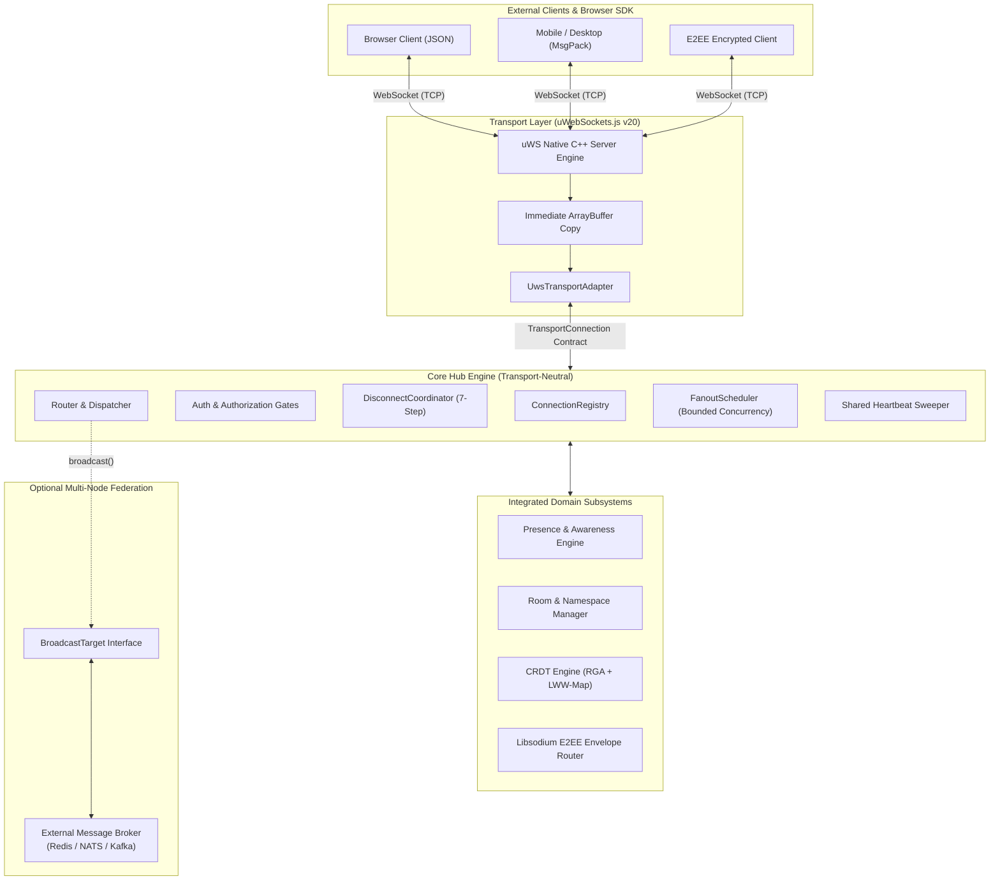
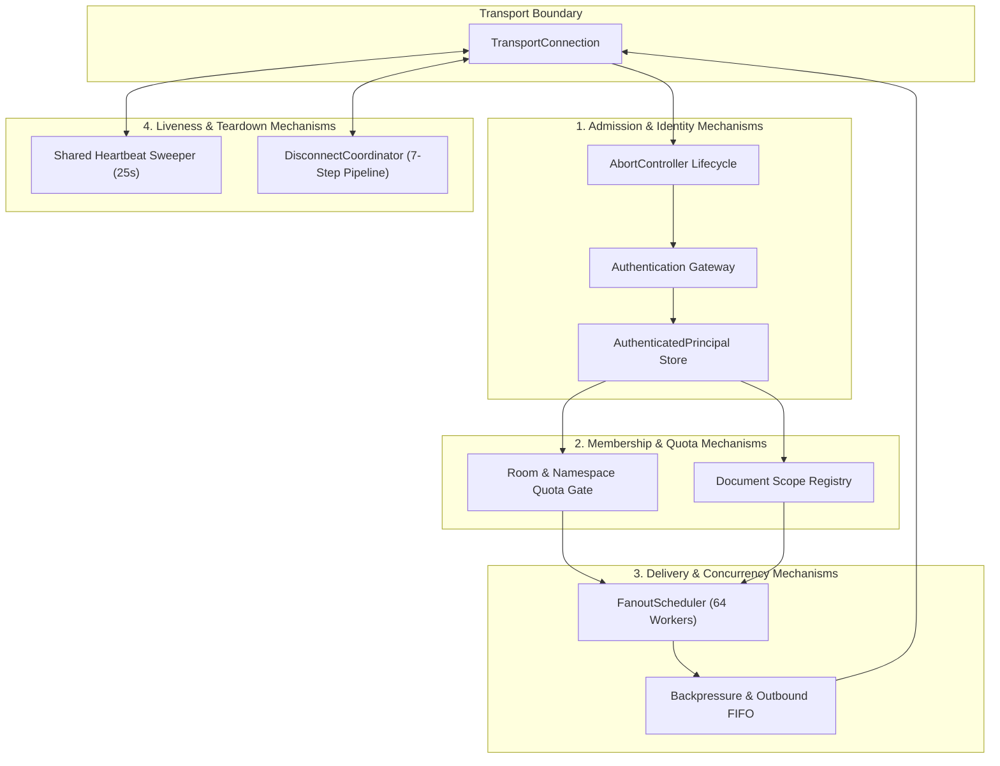
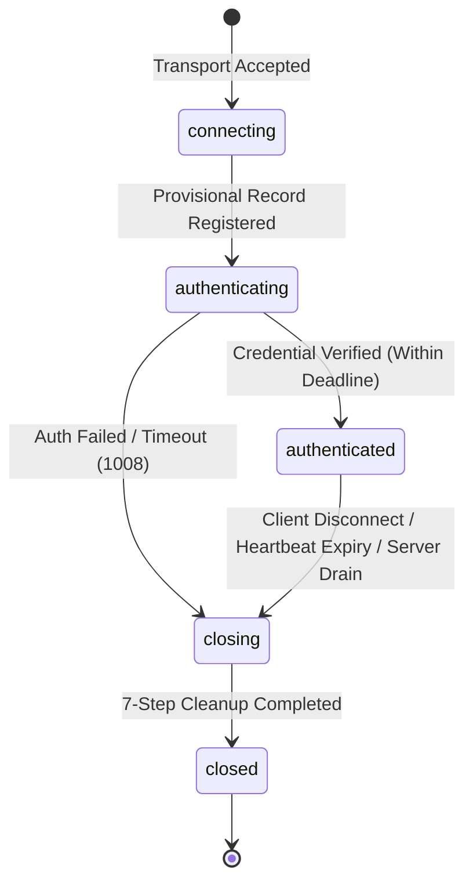
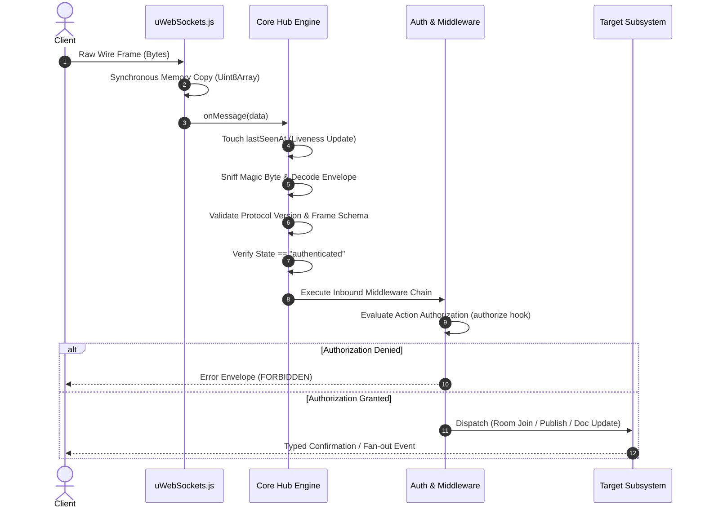
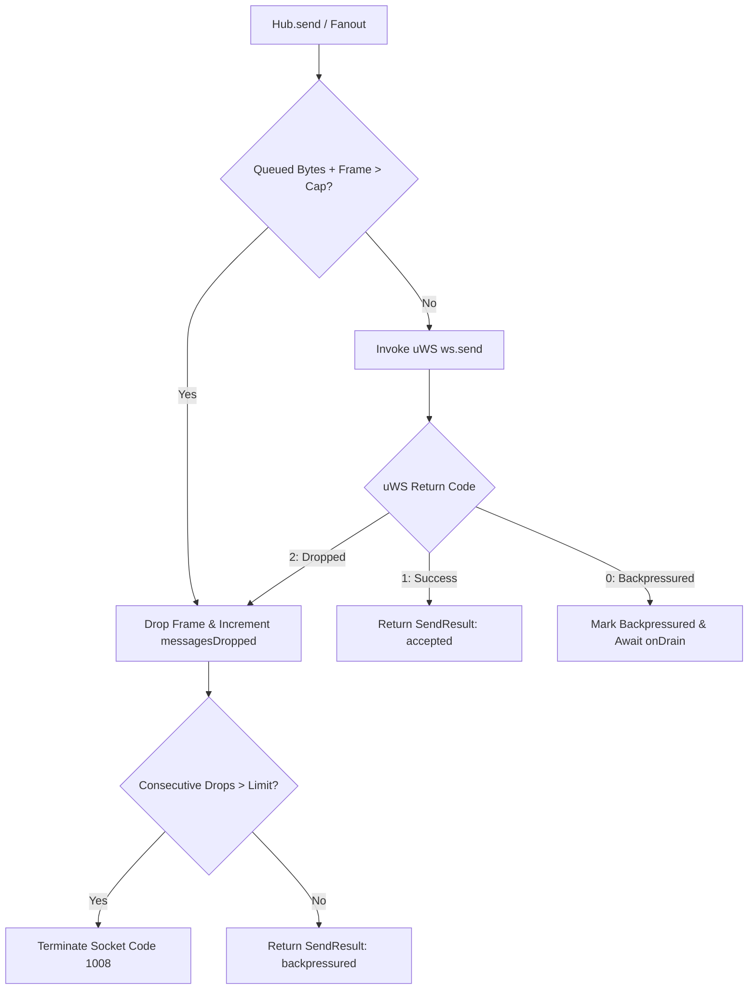
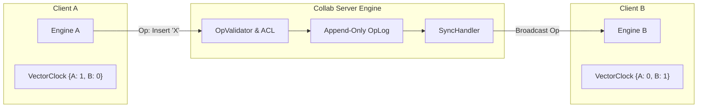
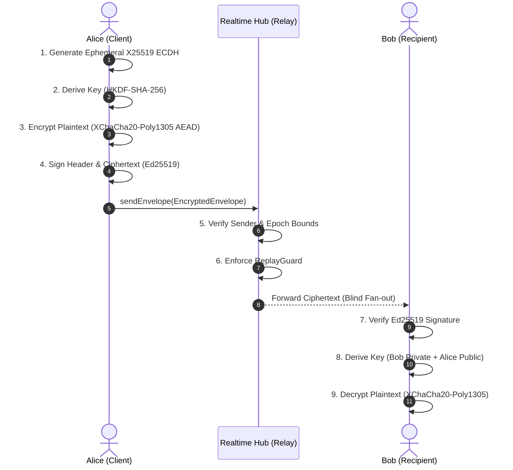

# Technical Architecture Specification — `@oneunit/realtime`

**Package:** `@oneunit/realtime`  
**Version:** `1.0.0-beta`  
**Target Environment:** Node.js `>= 20.0.0` (ESM)  
**Status:** Beta Technical Architecture Specification

> [!NOTE]
> **Beta Status (`v1.0.0-beta`)**: This architecture document describes the active beta implementation. The package is undergoing testing and validation, and is **not yet recommended for production deployments**. Architectural contracts and subsystem interfaces are subject to refinement prior to general availability.

---

## Table of Contents

- [1. Executive Architectural Summary](#1-executive-architectural-summary)
- [2. Design Tenets & Hexagonal Foundation](#2-design-tenets--hexagonal-foundation)
- [3. The Core Mechanisms ("Machisms") Subsystem & Engine Architecture](#3-the-core-mechanisms-machisms-subsystem--engine-architecture)
  - [3.1 Structural Design & Topology](#31-structural-design--topology)
  - [3.2 Core Logic & Algorithmic Invariants](#32-core-logic--algorithmic-invariants)
  - [3.3 Integration Patterns](#33-integration-patterns)
- [4. Transport Layer & uWebSockets.js v20 Integration](#4-transport-layer--uwebsocketsjs-v20-integration)
- [5. Protocol, Wire Framing & Serialization](#5-protocol-wire-framing--serialization)
- [6. Connection Lifecycle & State Machine](#6-connection-lifecycle--state-machine)
- [7. Inbound Message Processing Pipeline](#7-inbound-message-processing-pipeline)
- [8. Routing, Dispatch & Delivery Semantics](#8-routing-dispatch--delivery-semantics)
- [9. Adaptive Backpressure & Resource Defense](#9-adaptive-backpressure--resource-defense)
- [10. Single-Timer Heartbeat & Liveness Engine](#10-single-timer-heartbeat--liveness-engine)
- [11. Subsystem: Collaboration Engine (CRDTs)](#11-subsystem-collaboration-engine-crdts)
- [12. Subsystem: Presence & Multi-Device Awareness](#12-subsystem-presence--multi-device-awareness)
- [13. Subsystem: Rooms, Namespaces & Encryption Gates](#13-subsystem-rooms-namespaces--encryption-gates)
- [14. Subsystem: End-to-End Encryption (E2EE)](#14-subsystem-end-to-end-encryption-e2ee)
- [15. First-Party Client SDK Architecture](#15-first-party-client-sdk-architecture)
- [16. Concurrency, Atomicity & Memory Budget](#16-concurrency-atomicity--memory-budget)
- [17. Fault Isolation, Resilience & Error Model](#17-fault-isolation-resilience--error-model)
- [18. Specific Use Cases & Architectural Walkthroughs](#18-specific-use-cases--architectural-walkthroughs)
- [19. Practical Deployment Scenarios](#19-practical-deployment-scenarios)
- [20. Verification, Testing & Fault Injection](#20-verification-testing--fault-injection)

---

## 1. Executive Architectural Summary

`@oneunit/realtime` is a **high-throughput, transport-neutral, single-process realtime runtime for Node.js**. It provides connection lifecycle supervision, in-memory room/channel fan-out, document state synchronization, multi-device presence tracking, adaptive backpressure defense, single-timer liveness sweeps, Conflict-free Replicated Data Types (CRDTs), and zero-knowledge End-to-End Encryption (E2EE).

The runtime is architectured around a strict separation of concerns:
1. **The Core Hub Engine** is completely transport-agnostic and broker-free. It interacts exclusively with an abstract `TransportConnection` contract (`send`, `close`, `terminate`, `bufferedBytes`, `onMessage`, `onClose`, `onDrain`).
2. **The Primary Transport Adapter** utilizes `uWebSockets.js` v20, delegating TCP management, HTTP parsing, and WebSocket framing to an optimized native C++ event loop.
3. **Application Integrations** hook host-process lifecycle events (Express, Fastify, Koa, raw `node:http`) while routing WebSocket traffic to the dedicated uWS engine.



---

## 2. Design Tenets & Hexagonal Foundation

1. **Transport Neutrality**: The core hub never imports `uwebsocket`, `ws`, `express`, or any network package. It sees only `TransportConnection`. All business logic and membership graphs can be tested in memory using mock connections without binding network sockets.
2. **Kernel-Grade Performance**: Native network I/O is owned by `uWebSockets.js` v20, bypassing Node.js HTTP/WebSocket overhead and achieving microsecond fan-out latencies.
3. **Bounded Everything**: Every resource is capped. Connections, outbound queues, frame byte lengths, room memberships, document subscriptions, and fan-out concurrency have hard ceilings.
4. **Deterministic Fault Containment**: Failures are strictly isolated to their ownership domain. A slow, disconnected, or malformed peer never halts broadcasts to healthy peers or crashes the hub.
5. **Zero-Trust Identity**: Client payloads are never trusted as identity claims. A verified `Principal` is bound only via secure authentication hooks during the connection handshake.
6. **Explicit Delivery Semantics**: A transport-accepted write signifies local socket acceptance, not remote peer acknowledgement. Delivery returns a typed `PublishResult`, never a naive boolean.
7. **Single Shared Heartbeat**: A single unref'd timer sweeps all connections, eliminating tens of thousands of individual `setInterval` timers.
8. **Fail-Closed Security**: Cryptographic operations, authorization evaluations, and schema validations fail closed. Unauthenticated or unauthorized actions are immediately rejected.
9. **Single-Process Honesty**: The package makes no false claims of distributed consistency. Cross-node synchronization is explicitly delegated to external brokers via the `BroadcastTarget` contract.

---

## 3. The Core Mechanisms ("Machisms") Subsystem & Engine Architecture

The runtime engine of `@oneunit/realtime` is built upon a coordinated suite of **Core Mechanisms** (internally designated as the core "machisms" / runtime mechanisms). Rather than treating real-time interactions as loose event listeners, each mechanism is a formalized, deterministic controller that enforces specific lifecycle and safety invariants:

```
  ┌────────────────────────────────────────────────────────────────────────┐
  │                   Core Mechanisms ("Machisms") Engine                  │
  ├──────────────────────────────────┬─────────────────────────────────────┤
  │ 1. Handshake & Admission         │ Origin validation, provisional state│
  │ 2. Auth & Principal Binding      │ Deadline-bounded token verification │
  │ 3. Room & Capacity Reservation   │ Atomic slot check & composite keys  │
  │ 4. Document Scope & Subscriptions│ Tenant-partitioned collaborative set│
  │ 5. FanoutScheduler Dispatch      │ Concurrency cap (64), per-peer queue│
  │ 6. Adaptive Backpressure Defense │ Drop limits, consecutive-drop purge │
  │ 7. Single Heartbeat Sweeper      │ Sliding window, unref'd O(N) sweep  │
  │ 8. Idempotent 7-Step Disconnect  │ Single-flight teardown pipeline     │
  │ 9. CRDT State Convergence        │ Vector clocks, causal RGA ordering  │
  │ 10. E2EE Envelope & Replay Guard │ Libsodium AEAD, anti-replay window  │
  │ 11. Presence Lease Aggregator    │ Multi-device aggregate status & TTL │
  └──────────────────────────────────┴─────────────────────────────────────┘
```

### 3.1 Structural Design & Topology

The mechanisms subsystem operates as the central control plane of the Hub:



### 3.2 Core Logic & Algorithmic Invariants

#### Mechanism 1: Handshake & Provisional Admission
- **Invariant**: No unauthenticated socket may occupy room membership or consume broadcast CPU.
- **Logic**:
  1. Inspect HTTP Upgrade request headers and URL parameters.
  2. Verify origin allowlist (`allowedOrigins`). Reject unlisted origins immediately.
  3. Create a provisional record in `ConnectionRegistry` with state `connecting`.
  4. Instantiate an `AbortController`. Attach abort listener to the transport socket.
  5. Transition state to `authenticating` and start authentication deadline timer (`authTimeoutMs`).

#### Mechanism 2: Authentication & Principal Binding
- **Invariant**: Client payloads are never trusted for identity claims; identity is established strictly by server verification.
- **Logic**:
  1. Execute `authProvider.authenticate(credential, { signal, handshake })`.
  2. Race the authentication promise against `authTimeoutMs` and the abort signal.
  3. On success, store the sealed `AuthenticatedPrincipal` (`userId`, `tenantId`, `roles`, `sessionId`).
  4. Transition state to `authenticated`, send `welcome` envelope, and activate inbound frame processing.
  5. On error or timeout, terminate socket with WebSocket code `1008` (Policy Violation) and purge provisional state.

#### Mechanism 3: Room & Namespace Capacity Reservation
- **Invariant**: Room membership must never exceed configured capacity, even under highly concurrent join races.
- **Logic**:
  1. Validate room identifier using composite format: `tenantId:namespace:roomId`.
  2. Check `roomCapacities[roomId]`.
  3. Atomically reserve slot before asynchronous side-effects.
  4. After any `await` boundary, re-verify connection state (`authenticated`) and room capacity.
  5. Add membership idempotently into bidirectional index (`Map<roomId, Set<connectionId>>` and `Map<connectionId, Set<roomId>>`).

#### Mechanism 4: Document Scope & Subscription Management
- **Invariant**: Document operations must be strictly partitioned by `{ tenantId, documentId }` to eliminate cross-tenant leakage.
- **Logic**:
  1. Encode document scope as canonical JSON: `JSON.stringify([scope.tenantId, scope.documentId])`.
  2. Verify subscriber holds `read` or `write` permission via `authorize` hook.
  3. Register connection in `MemoryDocumentSubscriptions`.
  4. Document broadcasts include the sender by default (`excludeSender: false`) to ensure state convergence across all editors.

#### Mechanism 5: Fanout Scheduling & Concurrency Bounds
- **Invariant**: Asynchronous broadcast operations must not spawn unbounded floating promises or starve the V8 event loop.
- **Logic**:
  1. The `FanoutScheduler` enforces a global concurrency ceiling (default: 64 concurrent writes).
  2. Each connection owns a private FIFO queue of outbound frames.
  3. Work is scheduled across a worker pool that pulls from active connection queues.
  4. A slow socket drains independently; its latency has zero impact on fast sockets.

#### Mechanism 6: Adaptive Backpressure & Slow-Consumer Defense
- **Invariant**: Unresponsive or slow peers must not cause heap bloat or hub crashes.
- **Logic**:
  1. Every frame enqueued increments the connection's `queuedBytes`.
  2. If `queuedBytes + frameSize > maxQueuedBytesPerConnection` (default: 256 KiB), the frame is dropped for that peer (`status: "backpressured"`) and `messagesDropped` metric is incremented.
  3. Native uWS backpressure return codes (0 = backpressured, 1 = success, 2 = dropped) are monitored.
  4. If consecutive drops exceed safety limits, the connection is forcibly terminated.

#### Mechanism 7: Single Shared Heartbeat Sweeper
- **Invariant**: Liveness monitoring must scale to tens of thousands of sockets with zero timer allocation overhead.
- **Logic**:
  1. A single unref'd timer runs every `pingIntervalMs` (25s).
  2. Scans `ConnectionRegistry` and checks `currentTime - lastSeenAt`.
  3. If elapsed time exceeds `pongTimeoutMs` (75s), triggers idempotent disconnect with reason `"heartbeat expiry"`.
  4. Calling `.unref()` ensures the timer never blocks clean process shutdown.

#### Mechanism 8: Idempotent 7-Step Disconnect Pipeline
- **Invariant**: Teardown must be atomic, idempotent, and race-free regardless of whether disconnect was initiated by client close, network drop, timeout, or server shutdown.
- **Pipeline Execution**:
  1. `stepClose`: Mark state as `closing`; trigger `AbortController.abort()`.
  2. `stepRemoveMemberships`: Purge all room memberships; emit leave notifications.
  3. `stepRemoveDocumentSubscriptions`: Purge all document subscriptions.
  4. `stepReleasePresence`: Release ephemeral presence lease and recalculate user status.
  5. `stepSettleDelivery`: Purge and drop pending outbound queues.
  6. `stepCloseTransport`: Close underlying uWS socket with code `1000` or `1001`.
  7. `stepMarkClosed`: Mark state as `closed`, delete registry references, and decrement counters.

### 3.3 Integration Patterns

1. **Host Server Integration Pattern**: HTTP frameworks (Express, Fastify, Koa) run on standard HTTP ports; `@oneunit/realtime` owns the WebSocket port. Lifecycle adapters hook `httpServer.on("close")` or `fastify.onClose` to trigger graceful draining.
2. **Broker Integration Pattern**: Multi-node clusters wire `BroadcastTarget` to Redis Pub/Sub, Kafka, or NATS. Messages from the broker are delivered locally via `hub.broadcast(channel, payload)`.
3. **Storage Persistence Pattern**: Collaborative CRDT documents bind to databases via `CollaborationStorage` (`getOperationsSince`, `appendOperation`, `getSnapshot`, `saveSnapshot`).

---

## 4. Transport Layer & uWebSockets.js v20 Integration

### 4.1 The uWS Architecture
`@oneunit/realtime` uses `uWebSockets.js` v20 as its primary WebSocket engine. By executing on a native C++ event loop outside the standard Node stream layer, it delivers:
- Zero-copy socket read/write loops.
- Minimal V8 object allocation per frame.
- High memory efficiency (~2–4 KiB per idle connection).

### 4.2 Operating Modes
1. **Dedicated Mode (Default)**: `UwsTransportAdapter` instantiates its own `uWS.App` and binds to `config.port`. Framework servers run on their own port. Reverse proxies route `/ws` to the uWS port.
2. **Native Mode**: The adapter mounts directly onto an existing `uWS.App` via `adapter.mount(app)`.

### 4.3 Memory Safety: Immediate ArrayBuffer Copy
In `uWebSockets.js`, `ArrayBuffer` instances provided to the `message` callback are allocated in native memory and **recycled immediately after the callback returns**. Accessing the buffer asynchronously causes memory corruption.

The `UwsTransportAdapter` enforces a strict invariant: **the raw buffer is copied into a newly allocated `Uint8Array` synchronously** before dispatching to any asynchronous handler:

```typescript
// Synchronous copy in transport callback
const slice = new Uint8Array(isBinary ? message : new Uint8Array(message).slice(0));
connection.handleMessage(slice);
```

---

## 5. Protocol, Wire Framing & Serialization

### 5.1 Versioned Wire Envelope

```typescript
export interface RealtimeEnvelope<T = unknown> {
  protocolVersion: 1;
  type: ClientEventType | string;
  channel?: string;
  payload: T;
  error?: PublicError;
  correlationId?: string;
  timestamp?: number;
}
```

### 5.2 Dual-Codec Engine
- **JSON Codec (`jsonCodec`)**: UTF-8 encoded text for human-readable debugging and browser clients.
- **MessagePack Codec (`messagepackCodec`)**: Compact binary encoding powered by `notepack.io` for high wire efficiency.

### 5.3 Magic-Byte Auto-Detection
The server inspects the first byte of the first frame:
- `0x7B` (`{`), `0x5B` (`[`), or `0x22` (`"`) $\to$ **JSON**
- All other initial bytes $\to$ **MessagePack**

The negotiated codec is cached on the connection record for all future inbound and outbound frames.

---

## 6. Connection Lifecycle & State Machine

Every socket transitions through a strict 5-stage state machine:



### State Transition Rules

| State | Allowed Operations | Queue Policy | Eviction / Timeout |
|---|---|---|---|
| `connecting` | Internal transport registration | Drop all frames | Immediate transition |
| `authenticating` | Auth verification running | Queue up to 16 KiB | `authTimeoutMs` (7.5s) |
| `authenticated` | Full pub/sub, rooms, documents | Full outbound queue | Active until disconnect |
| `closing` | Cleanup execution; reject publishes | Drop outbound queues | Disconnect initiated |
| `closed` | None; transport terminated | Buffers freed | Terminal state |

---

## 7. Inbound Message Processing Pipeline



---

## 8. Routing, Dispatch & Delivery Semantics

### 8.1 The Router Dispatcher
- **Room Fan-out**: Queries `RoomAdapter`. Excludes the sender by default (`excludeSender: true`).
- **Document Fan-out**: Queries `DocumentAdapter`. Includes the sender by default (`excludeSender: false`) to ensure CRDT state convergence across all editors.
- **Direct Send**: Targets a single connection ID.

### 8.2 Delivery Result Semantics
Publishing returns an explicit `PublishResult` union type:

```typescript
export type PublishResult =
  | { status: "delivered"; recipientCount: number }
  | { status: "partial"; delivered: number; failed: number }
  | { status: "rejected"; reason: string };
```

---

## 9. Adaptive Backpressure & Resource Defense



- **Per-Socket Isolation**: A slow client's queue cap drops frames without blocking healthy clients.
- **No-Throw Guarantee**: `Hub.publish()` and `Hub.broadcast()` never throw on client backpressure.

---

## 10. Single-Timer Heartbeat & Liveness Engine

- A single unref'd timer sweeps all connections every `pingIntervalMs` (25s).
- Any inbound frame resets `connection.lastSeenAt`.
- Connections with no activity past `pongTimeoutMs` (75s) are terminated with reason `"heartbeat expiry"`.
- Zero per-socket timers; minimal event loop overhead.

---

## 11. Subsystem: Collaboration Engine (CRDTs)

The `@oneunit/realtime/collab` subsystem implements Conflict-free Replicated Data Types for multi-user document editing.



### 11.1 Document Scope
Every operation is scoped to a composite identity:
```typescript
export interface DocumentScope {
  readonly tenantId: string;
  readonly documentId: string;
}
// Encoded as JSON array to prevent delimiter collision:
// '["tenant-1","doc-42"]'
```

### 11.2 CRDT Algorithms
1. **Replicated Growable Array (RGA)**: Causal character-level text editing. Deleted characters are tombstoned; concurrent inserts are ordered deterministically by actor ID.
2. **Last-Write-Wins Map (LWW-Map)**: Conflict-free object metadata updates.
3. **Vector Clocks**: Partial ordering to ensure causal operation application.

---

## 12. Subsystem: Presence & Multi-Device Awareness

- **Device Leases**: Devices register ephemeral leases with TTL expiry.
- **Aggregation Manager**: Aggregates multi-device leases for a user:
  - If any device is active $\to$ `online`.
  - If all devices are idle $\to$ `idle`.
  - If all leases expire $\to$ `offline`.
- **Ephemeral Awareness**: Live typing indicators and cursor streams broadcast without disk persistence.

---

## 13. Subsystem: Rooms, Namespaces & Encryption Gates

- **Composite Room Keys**: `tenantId:namespace:roomId` prevents cross-tenant access.
- **Capacity Limits**: Enforces room membership caps under concurrency locks.
- **Encryption Gates**: Enforces that joined members possess public keys when room policy is `e2ee_required`.

---

## 14. Subsystem: End-to-End Encryption (E2EE)

Zero-knowledge relay architecture using Libsodium:



- **Primitives**: X25519 (ECDH), HKDF-SHA-256, XChaCha20-Poly1305 (AEAD), Ed25519 (Signatures).
- **Replay Protection**: `ReplayGuard` maintains sliding sequence windows to detect duplicate envelopes.

---

## 15. First-Party Client SDK Architecture

Browser-safe SDK (`@oneunit/realtime/client`) with zero server dependencies:
- **Auto-Reconnection**: Exponential backoff with randomized jitter.
- **Channel Multiplexing**: Multiple named channels share a single WebSocket.
- **Codec Negotiation**: Transparent JSON and MessagePack framing.

---

## 16. Concurrency, Atomicity & Memory Budget

### 16.1 Concurrency Safety
- **State Re-verification**: Hub checks connection state after every `await` gap.
- **Synchronous Indexing**: Registry maps are updated synchronously.
- **Per-Socket FIFO**: Messages from a single socket process in arrival order.

### 16.2 Memory Footprint
- uWS Native Socket: ~2.5 KiB
- `TransportConnection`: ~1.2 KiB
- `ClientConnection`: ~1.5 KiB
- Total: **~55–65 MB for 10,000 idle connections**.

---

## 17. Fault Isolation, Resilience & Error Model

### Six-Domain Isolation Matrix
```
[Domain: Message]    Malformed frame rejected ───► Socket stays open
[Domain: Socket]     Slow consumer drops      ───► Other sockets unaffected
[Domain: Room]       Room capacity saturated  ───► Other rooms operate normally
[Domain: Adapter]    uWS listener crash       ───► State safely drained
[Domain: Observer]   Logging / Metrics throws ───► Core routing unimpeded
[Domain: Process]    OOM or fatal crash       ───► Clients fail over to sister pod
```

### Public Error Sanitization
Internal exceptions are sanitized via `ErrorRegistry`. Client frames contain safe error codes (`ROOM_FULL`, `UNAUTHENTICATED`) without leaking internal stack traces or secrets.

---

## 18. Specific Use Cases & Architectural Walkthroughs

### Use Case 1: Ultra-Low Latency Group Chat
- High-concurrency room fanout with sender exclusion (`excludeSender: true`).
- Pre-handshake JWT verification.
- Backpressure drop protection for slow mobile clients.

### Use Case 2: Collaborative CRDT Document Editing
- Document co-editing with causal RGA text sync and LWW-Map attributes.
- Full-participant fanout (`excludeSender: false`).
- Append-only `OpLog` and `SyncHandler` for offline reconnection sync.

### Use Case 3: Live Awareness & Multiplayer Canvas
- Ephemeral cursor streaming (`updateCursor`) and typing indicators.
- Non-persisted lightweight awareness frames fanned out at 60 Hz.

### Use Case 4: Zero-Knowledge Regulated Messaging
- Regulated healthcare or finance chat.
- Sealed Libsodium envelopes routed blindly by the hub.
- Server holds no private keys; payload privacy guaranteed.

### Use Case 5: High-Frequency Telemetry & Market Feeds
- Financial market feed broadcasting to tens of thousands of subscribers.
- MessagePack serialization for compact binary frames.
- Bounded concurrency in `FanoutScheduler`.

### Use Case 6: Edge WebSocket Termination Gateway
- Terminates client connections at the network edge.
- Authenticates tokens and routes frames to internal backend microservices.

---

## 19. Practical Deployment Scenarios

### Scenario A: Standalone Microservice
Single process running dedicated uWS listener on port `4001`:
```typescript
import { createRealtime } from "@oneunit/realtime";

const realtime = createRealtime({
  port: 4001,
  limits: { maxConnections: 50_000 },
});

await realtime.listen();
```

### Scenario B: Reverse Proxy Deployment (Nginx / Caddy)
Nginx terminates TLS and routes `/ws` to uWS (`:4001`) and `/api` to Express (`:3000`):
```nginx
location /ws {
    proxy_pass http://127.0.0.1:4001;
    proxy_http_version 1.1;
    proxy_set_header Upgrade $http_upgrade;
    proxy_set_header Connection "Upgrade";
    proxy_read_timeout 90s;
}
```

### Scenario C: Multi-Node Horizontally Scaled Fleet (Redis Pub/Sub)
Federate independent realtime pods using Redis:
```typescript
import { createRealtime } from "@oneunit/realtime";
import { Redis } from "ioredis";

const realtime = createRealtime({ port: 4001 });
await realtime.listen();

const pub = new Redis(process.env.REDIS_URL);
const sub = new Redis(process.env.REDIS_URL);

await sub.psubscribe("realtime:*");
sub.on("pmessage", (_p, ch, msg) => {
  const channel = ch.replace("realtime:", "");
  void realtime.hub.broadcast(channel, JSON.parse(msg));
});
```

### Scenario D: Containerized Kubernetes Deployment with Graceful Drain
- Readiness and liveness probes targeting uWS port.
- `terminationGracePeriodSeconds: 30`.
- Application handles `SIGTERM` by invoking `realtime.close({ timeoutMs: 5_000 })`.

---

## 20. Verification, Testing & Fault Injection

The codebase is validated by an automated test suite across unit, contract, and integration layers:

```
test/
├── core/                         # Hub unit tests (state machine, capacity, rooms)
├── transport/                    # uWS transport contract tests & integration
├── protocol/                     # Codec framing, magic byte sniffer, validation
├── presence/                     # Leases, aggregation, awareness, expiry
├── room-namespace/               # Namespace routing, room keys, encryption gates
├── collab/                       # RGA text convergence, vector clocks, LWW-Map
├── e2ee/                         # Libsodium sealing, unsealing, replay protection
├── event/                        # EventService, delivery modes, fan-out scheduler
├── error/                        # Error registry, circuit breaker, retry deadlines
├── client/                       # Client SDK, channel multiplexing, auto-reconnect
└── integration/                  # End-to-end full server handshake & fan-out tests
```

### Fault Injection Tests
- **Backpressure Drops**: Sockets simulate congestion to verify byte cap enforcement.
- **Throwing Transports**: Sockets throw exceptions during broadcast to verify peer isolation.
- **Hanging Auth**: Asynchronous auth hangs indefinitely to verify `authTimeoutMs` eviction.
- **Replay Attacks**: Injected duplicate envelopes verify `ReplayGuard` rejection.
