# Technical Architecture Specification — `@oneunit/realtime`

**Package:** `@oneunit/realtime`  
**Version:** `1.0.0-beta`  
**Target Environment:** Node.js `>= 20.0.0` (ESM)  
**Status:** Canonical Technical Architecture Specification

---

## Table of Contents

- [1. Executive Architectural Summary](#1-executive-architectural-summary)
- [2. Design Tenets & Engineering Principles](#2-design-tenets--engineering-principles)
- [3. System Topography & Module Decomposition](#3-system-topography--module-decomposition)
- [4. Transport Layer & Host Integration](#4-transport-layer--host-integration)
- [5. Protocol, Wire Framing & Serialization](#5-protocol-wire-framing--serialization)
- [6. Connection Lifecycle & State Machine](#6-connection-lifecycle--state-machine)
- [7. Inbound Message Processing Pipeline](#7-inbound-message-processing-pipeline)
- [8. Routing, Dispatch & Delivery Semantics](#8-routing-dispatch--delivery-semantics)
- [9. Adaptive Backpressure & Resource Defense](#9-adaptive-backpressure--resource-defense)
- [10. Single-Timer Heartbeat & Liveness Engine](#10-single-timer-heartbeat--liveness-engine)
- [11. Subsystem: Presence & Multi-Device Awareness](#11-subsystem-presence--multi-device-awareness)
- [12. Subsystem: Rooms, Namespaces & Encryption Gates](#12-subsystem-rooms-namespaces--encryption-gates)
- [13. Subsystem: CRDT Collaborative Editing](#13-subsystem-crdt-collaborative-editing)
- [14. Subsystem: End-to-End Encryption (E2EE)](#14-subsystem-end-to-end-encryption-e2ee)
- [15. First-Party Client SDK Architecture](#15-first-party-client-sdk-architecture)
- [16. Concurrency, Atomicity & Ordering Guarantees](#16-concurrency-atomicity--ordering-guarantees)
- [17. Fault Isolation, Resilience & Error Model](#17-fault-isolation-resilience--error-model)
- [18. Multi-Node Federation & Broker Scaling](#18-multi-node-federation--broker-scaling)
- [19. Memory Layout & Capacity Engineering](#19-memory-layout--capacity-engineering)
- [20. Verification, Testing & Fault Injection](#20-verification-testing--fault-injection)

---

## 1. Executive Architectural Summary

`@oneunit/realtime` is a **high-throughput, transport-neutral, single-process realtime runtime for Node.js**. It provides connection lifecycle supervision, in-memory room/channel fan-out, document state synchronization, multi-device presence tracking, adaptive backpressure defense, single-timer liveness sweeps, Conflict-free Replicated Data Types (CRDTs), and zero-knowledge End-to-End Encryption (E2EE).

The runtime is architectured around a strict separation of concerns:
1. **The Core Hub Engine** is completely transport-agnostic and broker-free. It interacts exclusively with an abstract `TransportConnection` contract.
2. **The Production Transport Adapter** utilizes `uWebSockets.js` v20, delegating TCP management, HTTP parsing, and WebSocket framing to an optimized native C++ event loop.
3. **Application Integrations** hook host-process lifecycle events (Express, Fastify, Koa, raw `node:http`) while routing WebSocket traffic to the dedicated uWS engine.

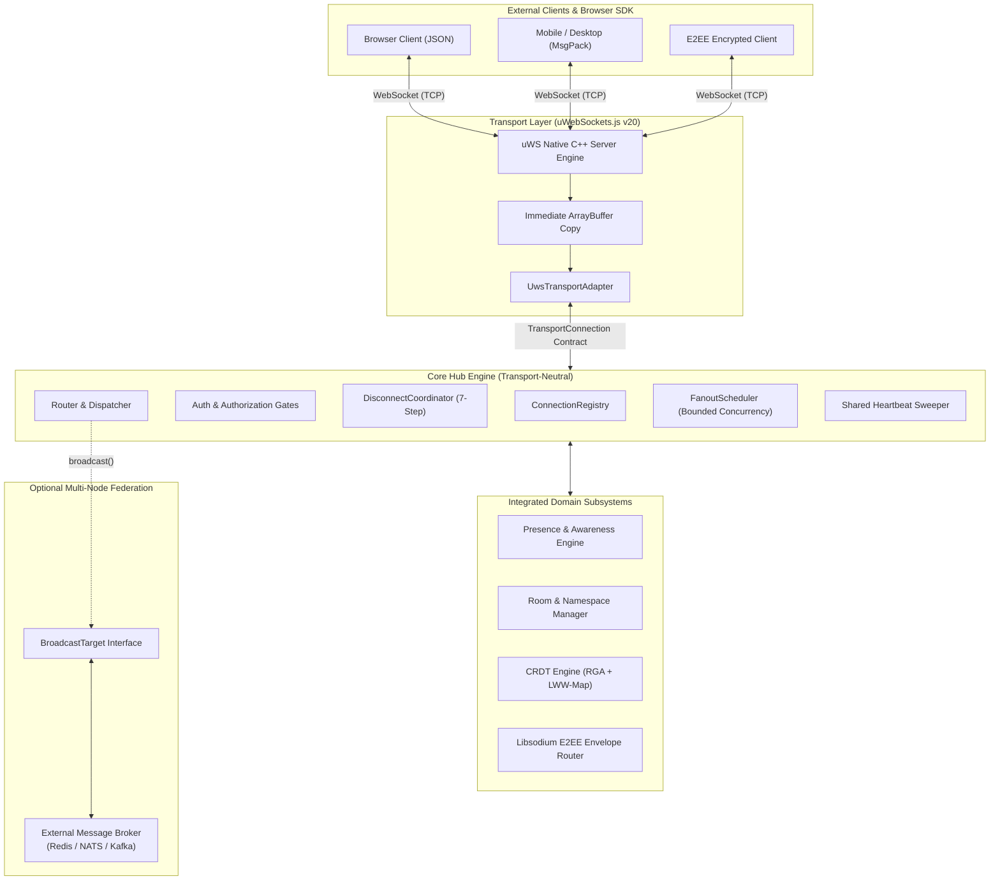

---

## 2. Design Tenets & Engineering Principles

1. **Transport Neutrality**: The core hub never imports `uwebsocket`, `ws`, `express`, or any network package. It sees only `TransportConnection`. All business logic and membership graphs can be tested in memory using mock connections without binding network sockets.
2. **Kernel-Grade Performance**: Production network I/O is owned by `uWebSockets.js` v20, bypassing Node.js HTTP/WebSocket overhead and achieving microsecond fan-out latencies.
3. **Bounded Everything**: Every resource is capped. Connections, outbound queues, frame byte lengths, room memberships, document subscriptions, and fan-out concurrency have hard ceilings.
4. **Deterministic Fault Containment**: Failures are strictly isolated to their ownership domain. A slow, disconnected, or malformed peer never halts broadcasts to healthy peers or crashes the hub.
5. **Zero-Trust Identity**: Client payloads are never trusted as identity claims. A verified `Principal` is bound only via secure authentication hooks during the connection handshake.
6. **Explicit Delivery Semantics**: A transport-accepted write signifies local socket acceptance, not remote peer acknowledgement. Delivery returns a typed `PublishResult`, never a naive boolean.
7. **Single Shared Heartbeat**: A single unref'd timer sweeps all connections, eliminating tens of thousands of individual `setInterval` timers.
8. **Fail-Closed Security**: Cryptographic operations, authorization evaluations, and schema validations fail closed. Unauthenticated or unauthorized actions are immediately rejected.
9. **Single-Process Honesty**: The package makes no false claims of distributed consistency. Cross-node synchronization is explicitly delegated to external brokers via the `BroadcastTarget` contract.

---

## 3. System Topography & Module Decomposition

### Directory & Source Structure

```
src/
├── index.ts                      # Curated default public API barrel
├── types.ts                      # Shared canonical types across all packages
│
├── public/                       # High-level entry point facade
│   └── create-realtime.ts        # createRealtime facade, RealtimeServer state machine
│
├── core/                         # Pure transport-neutral runtime
│   ├── core-hub.ts               # Hub class — connection, rooms, docs, pub/sub, cleanup
│   ├── connection/
│   │   ├── connection.types.ts   # TransportConnection, ClientConnection, Principal
│   │   └── connection-registry.ts# Connection records & O(1) multi-index lookups
│   ├── auth/
│   │   └── auth-provider.ts      # AuthProvider contract & anonymousAuthProvider
│   ├── rooms/
│   │   └── room-adapter.ts       # Room membership, capacity checks, tenant boundaries
│   ├── documents/
│   │   └── document-adapter.ts   # Document subscriptions (read/write permissions)
│   ├── presence/
│   │   └── presence-adapter.ts   # Core hub presence mapping
│   ├── routing/
│   │   └── router.ts             # Dispatcher to rooms, documents, and recipients
│   ├── cleanup/
│   │   └── disconnect-coordinator.ts # 7-step idempotent disconnect pipeline
│   ├── middleware/
│   │   └── middleware-runner.ts  # Inbound action middleware chain runner
│   └── infrastructure/
│       ├── clock.ts              # Monotonic and wall-clock time abstractions
│       ├── id-generator.ts       # UUID v4 generator
│       └── metrics.ts            # Silent metrics recorder
│
├── transport/                    # Concrete transport adapters
│   ├── index.ts
│   ├── create-transport.ts       # RealtimeTransport factory
│   ├── attach.ts                 # Server attach helpers
│   ├── uws/
│   │   └── uws-transport.ts      # UwsTransportAdapter (uWebSockets.js v20 engine)
│   ├── node-http/
│   │   └── node-http-transport.ts# Fallback/compatibility transport helpers
│   └── testing/
│       └── transport-connection.ts # FakeTransport for unit & contract testing
│
├── protocol/                     # Versioned envelope & wire codecs
│   ├── types.ts                  # RealtimeEnvelope<T> definitions
│   ├── json.ts                   # JSON codec implementation
│   ├── messagepack.ts            # MessagePack codec (notepack.io)
│   └── index.ts                  # encodeFrame, decodeFrame, auto-detection
│
├── presence/                     # Full multi-device presence subsystem
│   ├── service.ts                # PresenceService business logic
│   ├── lease-manager.ts          # Ephemeral device leases & TTL calculation
│   ├── aggregation-manager.ts    # Multi-device user presence aggregation
│   ├── awareness-manager.ts      # Typing indicators & cursor tracking
│   ├── storage.ts                # Memory & Redis-compatible PresenceStore
│   ├── router.ts                 # Presence WebSocket & HTTP router
│   └── sdk.ts                    # TypeScript presence client SDK
│
├── room-namespace/               # Room & namespace isolation subsystem
│   ├── router.ts                 # RoomNamespaceRouter
│   ├── namespace-manager.ts      # Multi-tenant namespace manager
│   ├── room-manager.ts           # Room lifecycle & capacity management
│   ├── membership-manager.ts     # Room membership records
│   ├── encryption-gate.ts        # Key epoch & encryption validation gate
│   └── room-key.ts               # Encoded composite room keys
│
├── collab/                       # In-process CRDT collaboration engine
│   ├── core/
│   │   ├── rga.ts                # Replicated Growable Array (text CRDT)
│   │   ├── map-lww.ts            # Last-Write-Wins Map CRDT
│   │   ├── vector-clock.ts       # Causal vector clocks
│   │   └── encode.ts             # Compact binary operation serialization
│   ├── server/
│   │   ├── collaboration.ts      # Collaboration server controller
│   │   ├── sync-handler.ts       # Version reconciliation & synchronization
│   │   ├── op-log.ts             # In-memory historical operation log
│   │   └── validator.ts          # Operation schema & permission validator
│   └── client/
│       ├── engine.ts             # CollaborationEngine client runtime
│       ├── document.ts           # Collaborative Document model
│       └── persistence.ts        # Client-side snapshot persistence
│
├── e2ee/                         # End-to-end encryption subsystem (Libsodium)
│   ├── envelope.ts               # EnvelopeService (seal/open operations)
│   ├── primitives.ts             # Cryptographic primitives (X25519, AEAD, Ed25519)
│   ├── canonical.ts              # Deterministic canonical byte serialization
│   ├── device-identity.ts        # DeviceIdentityManager
│   ├── key-directory.ts          # KeyDirectory contract & memory implementation
│   └── types.ts                  # EncryptedEnvelope, ReplayGuard, typed errors
│
├── event/                        # Bounded event delivery subsystem
│   ├── service.ts                # EventService
│   ├── fanout.ts                 # FanoutScheduler (concurrency & queue caps)
│   ├── ack.ts                    # Protocol-level ACK handler
│   └── delivery-state.ts         # At-least-once delivery state store
│
├── error/                        # Typed error system & resilience
│   ├── hub-error.ts              # Base HubError class
│   ├── registry.ts               # Error registry & public sanitization
│   ├── circuit-breaker.ts        # Circuit breaker implementation
│   ├── retry.ts                  # Exponential backoff retry utility
│   ├── deadline.ts               # Async deadline wrapper
│   └── logger.ts                 # Logger interface (SilentLogger, ConsoleLogger)
│
├── client/                       # First-party browser-safe client SDK
│   ├── client.ts                 # RealtimeClient (reconnect, auth, multiplexing)
│   ├── channel.ts                # RealtimeClientChannel (typed pub/sub)
│   └── transport.ts              # Isomorphic WebSocket transport adapter
│
└── host/                         # Framework lifecycle integrations
    └── host-server-adapter.ts    # Express, Fastify, Koa, node:http lifecycle hooks
```

### Inward Dependency Rules

The architectural layering enforces strict inward-pointing dependencies:

```
[host/**] ──────────┐
                    ▼
[transport/**] ──> [core/**] <── [subsystems (presence, collab, e2ee, event)]
                    ▲
[client/**] ────────┼──> [protocol/**]
                    │
[error/**] ─────────┘
```

1. **`core/**` depends ONLY on `error/**`, `protocol/**`, and internal contracts**. It NEVER imports `transport/**`, `host/**`, or external framework packages.
2. **`transport/**` depends on `core/**` contracts and the concrete WebSocket engine (`uwebsocket`)**.
3. **`host/**` depends on `public/**` and `core/**` solely for coordinating shutdown events**.
4. **`client/**` imports only `protocol/**` and browser-safe error utilities**. It has zero runtime dependencies on server packages.

---

## 4. Transport Layer & Host Integration

### 4.1 The uWebSockets.js v20 Engine

`@oneunit/realtime` adopts `uWebSockets.js` as its exclusive production WebSocket engine. uWS executes outside the standard Node.js stream pipeline, binding directly to native epoll/kqueue C++ sockets. This provides:
- Near-zero latency socket read/write operations.
- Minimal V8 object allocation per frame.
- High memory efficiency (~2–4 KiB per idle socket vs ~30–50 KiB in pure JS implementations).

### 4.2 Integration Modes

uWS owns its own native HTTP/WebSocket listener and cannot be attached to a Node.js `http.Server` `upgrade` event. The package provides two operating modes:

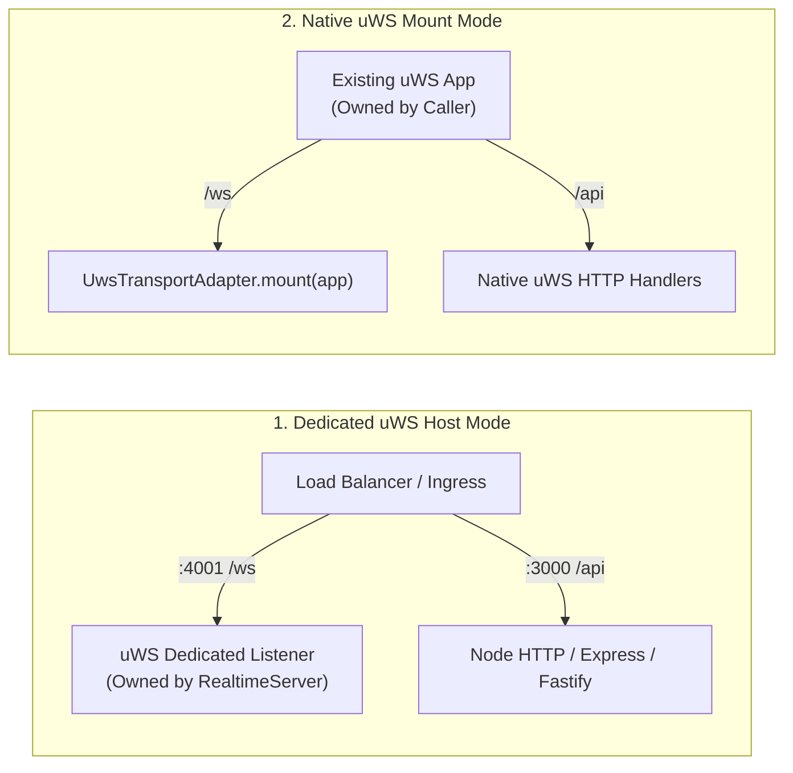

1. **Dedicated Mode (Default)**: The `UwsTransportAdapter` instantiates its own uWS `App` and binds to a designated port (`config.port`). Framework servers (Express/Fastify) run on their own port. Ingress proxies (Nginx/ALB) route WebSocket paths to the uWS port.
2. **Native Mode**: For applications already using `uWebSockets.js` as their primary HTTP server, the adapter mounts its routes directly onto the caller's existing `uWS.App` via `adapter.mount(app)`.

### 4.3 The `TransportConnection` Contract

The bridge between concrete sockets and the core hub is `TransportConnection`:

```typescript
export interface TransportConnection {
  readonly id: string;
  readonly handshake: HandshakeContext;
  send(data: Uint8Array, options?: SendOptions): Promise<SendResult>;
  close(code?: number, reason?: string): void;
  terminate(): void;
  bufferedBytes(): number;
  onMessage(handler: (data: Uint8Array) => void): Unsubscribe;
  onClose(handler: (event: TransportCloseEvent) => void): Unsubscribe;
  onDrain(handler: () => void): Unsubscribe;
}
```

### 4.4 Critical Memory Safety: Immediate ArrayBuffer Copy

In `uWebSockets.js`, `ArrayBuffer` instances delivered to the `message` callback are allocated in C++ memory and **recycled immediately after the callback returns**. Accessing the buffer asynchronously causes memory corruption or reads invalid bytes.

The `UwsTransportAdapter` enforces a strict memory invariant: **the raw buffer is copied into a newly allocated `Uint8Array` synchronously** before dispatching to any asynchronous handler:

```typescript
// src/transport/uws/uws-transport.ts
const slice = new Uint8Array(isBinary ? message : new Uint8Array(message).slice(0));
// Immediate dispatch of detached memory copy
connection.handleMessage(slice);
```

### 4.5 Framework Lifecycle Glue

The framework adapters (`expressRealtime`, `fastifyRealtime`, `koaRealtime`, `nodeHttpRealtime`) do not proxy sockets. They attach to the host application's shutdown events to trigger a clean drain and teardown of the uWS server:

```typescript
// src/host/host-server-adapter.ts
export function expressRealtime(app, realtime, options) {
  options?.httpServer?.on?.("close", () => {
    void realtime.close();
  });
}
```

### 4.6 Lifecycle Synchronization & Startup/Shutdown Races

`RealtimeServer` uses a serialized `lifecycleLock` promise chain to prevent race conditions between `start()` and `close()`:

- **Start During Drain**: Calling `start()` while the server is `draining` throws `REALTIME_CLOSING`.
- **Double Start**: Subsequent `start()` calls return the in-flight promise instead of creating a duplicate transport.
- **Double Close**: Subsequent `close()` calls return the in-flight shutdown promise.
- **Transport Guard**: If `start()` is cancelled while the transport adapter is being created, the adapter is always closed before the error propagates.
- **Unconditional Transport Closure**: `doClose()` wraps `hub.close()` in `try/finally`, so `adapter.close()` always executes even if hub shutdown throws.

---

## 5. Protocol, Wire Framing & Serialization

### 5.1 Versioned Wire Envelope

All communication between client and server is encapsulated in a standardized `RealtimeEnvelope<T>`:

```typescript
export interface RealtimeEnvelope<T = unknown> {
  protocolVersion: 1;
  type: ClientEventType | string;
  channel?: string;
  payload: T;
  error?: PublicError;
  correlationId?: string;
  timestamp?: number;
}
```

- `protocolVersion`: Currently `1`. Major version mismatches are rejected immediately.
- `type`: Action identifier (`join`, `leave`, `message`, `publish`, `subscribe`, `unsubscribe`, `ping`, `pong`, `welcome`, `error`).

### 5.2 Dual-Codec Engine: JSON & MessagePack

The protocol layer supports two serialization strategies:
1. **JSON Codec (`jsonCodec`)**: UTF-8 encoded text for human-readable debugging and simple browser clients.
2. **MessagePack Codec (`messagepackCodec`)**: High-performance compact binary encoding powered by `notepack.io` for production efficiency.

### 5.3 Magic-Byte Heuristic Codec Auto-Detection

The server automatically identifies the serialization format of every connection by inspecting the initial byte of the first frame:

```
First Byte Value:
  0x7B ('{')  ───► JSON Object
  0x5B ('[')  ───► JSON Array
  0x22 ('"')  ───► JSON String
  All Others  ───► MessagePack Binary
```

Once detected, the negotiated codec is cached on the connection record. Responses to that connection are serialized using the same codec.

---

## 6. Connection Lifecycle & State Machine

Every connection registered with the Hub transitions through a deterministic, strictly enforced 5-stage state machine:

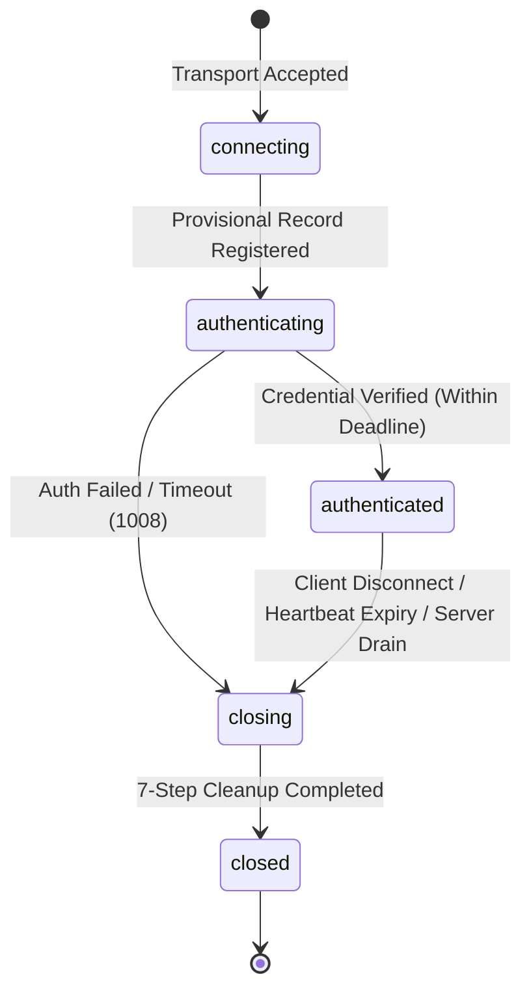

### 6.1 State Transition Matrix

| State | Allowed Operations | Buffer / Queue Policy | Timeout / Trigger |
|---|---|---|---|
| `connecting` | Internal transport registration only | Drops any data frames | Immediate transition |
| `authenticating` | Execution of `authProvider.authenticate` | Queues messages up to 16 KiB | `authTimeoutMs` (Default: 7.5s) |
| `authenticated` | Full pub/sub, room join, document sync | Full outbound queue (`maxQueuedBytesPerConnection`) | Active until disconnect |
| `closing` | Cleanup execution; rejection of new publishes | Drops outbound queues | Disconnect initiated |
| `closed` | None; transport terminated | Buffers freed; metrics decremented | Terminal state |

### 6.2 Pre-Handshake vs In-Band Authentication

1. **Pre-Handshake HTTP Authentication**: Credentials passed via query parameters (`?token=...`) or `Authorization` headers are validated during the WebSocket upgrade step. Invalid credentials are met with HTTP `401 Unauthorized` before establishing the TCP connection.
2. **In-Band Authentication**: If credentials must be refreshed or sent over the WebSocket itself, the connection remains in the `authenticating` state. If no valid credential is confirmed within `authTimeoutMs`, the connection is closed with code `1008` (Policy Violation).

### 6.3 The 7-Step Idempotent Disconnect Pipeline

Disconnections are managed exclusively by the `DisconnectCoordinator`. It guarantees that cleanup steps run in exact order and execute **exactly once**, even when triggered by concurrent events (e.g., client network loss racing against heartbeat timeout and server shutdown):

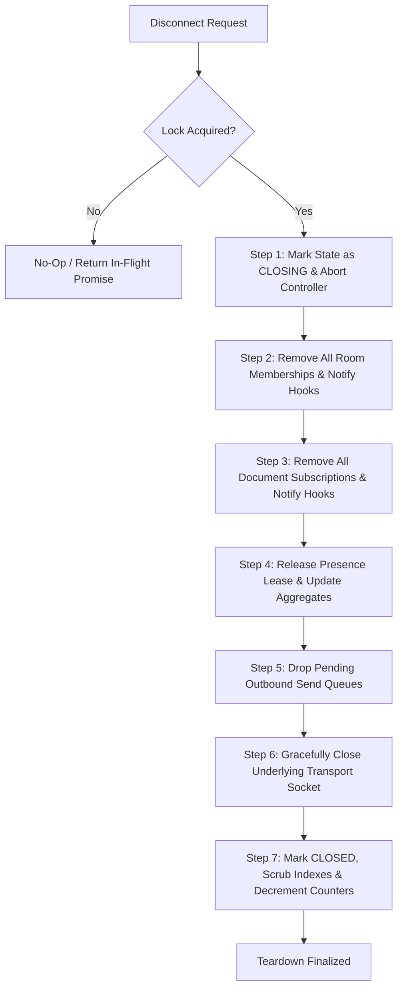

### 6.4 Connection Metrics Accuracy

The `hub.connections` gauge tracks **authenticated** connections only. A connection that fails authentication is never counted as "connected," so the disconnect cleanup path decrements `hub.connections` only when a connection previously reached the `authenticated` state and carried a `Principal`. Connections that fail before authentication produce no increment and therefore no corresponding decrement, keeping the gauge accurate and never negative.

---

## 7. Inbound Message Processing Pipeline

Every incoming network packet is processed through a sequential, non-blocking pipeline:

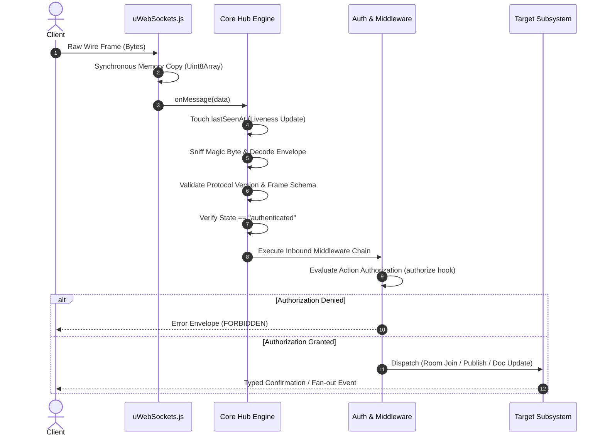

### Pipeline Steps in Detail

1. **Liveness Touch**: `registry.touch(connectionId)` updates the monotonic timestamp, resetting the heartbeat countdown.
2. **Codec Sniffing & Decoding**: The frame is decoded using the negotiated codec (`jsonCodec` or `messagepackCodec`).
3. **Envelope Validation**: Checks `protocolVersion === 1` and confirms required envelope properties (`type`, `channel`, `payload`).
4. **State Gate**: If `connection.state !== "authenticated"` and `type !== "ping"`, the frame is rejected with `ConnectionNotAuthenticatedError`.
5. **Middleware Execution**: Registered `Hub.use()` middleware executes sequentially.
6. **Authorization Gate**: The `authorize(action, principal, resourceId, tenantId)` hook evaluates permissions. A rejection short-circuits the pipeline with `ForbiddenError`.
7. **Action Dispatch**:
   - `join` ➔ `Hub.joinRoom(connectionId, channel)`
   - `leave` ➔ `Hub.leaveRoom(connectionId, channel)`
   - `message` / `publish` ➔ `Hub.publish(connectionId, event)`
   - `subscribe` ➔ `Hub.subscribeDocument(connectionId, documentId, permission)`
   - `unsubscribe` ➔ `Hub.unsubscribeDocument(connectionId, documentId)`
   - `ping` ➔ Reply immediately with `pong` envelope.
8. **Sanitized Error Containment**: Any thrown exception is caught, mapped through `ErrorRegistry`, sanitized of internal stack traces, and returned to the client as an `error` frame.

---

## 8. Routing, Dispatch & Delivery Semantics

### 8.1 The Router Dispatcher

The `Router` determines target recipients based on subscription semantics:
- **Room Fan-out**: Queries `RoomAdapter` for all member connections. **Excludes the sender by default** (`excludeSender: true`).
- **Document Fan-out**: Queries `DocumentAdapter` for all subscribers. **Includes the sender by default** (`excludeSender: false`) to ensure state convergence across all editors.
- **Direct Send**: Targets a single connection ID.

### 8.2 The FanoutScheduler

Fan-out is managed by the `FanoutScheduler`. It decouples publish throughput from peer socket write speeds:

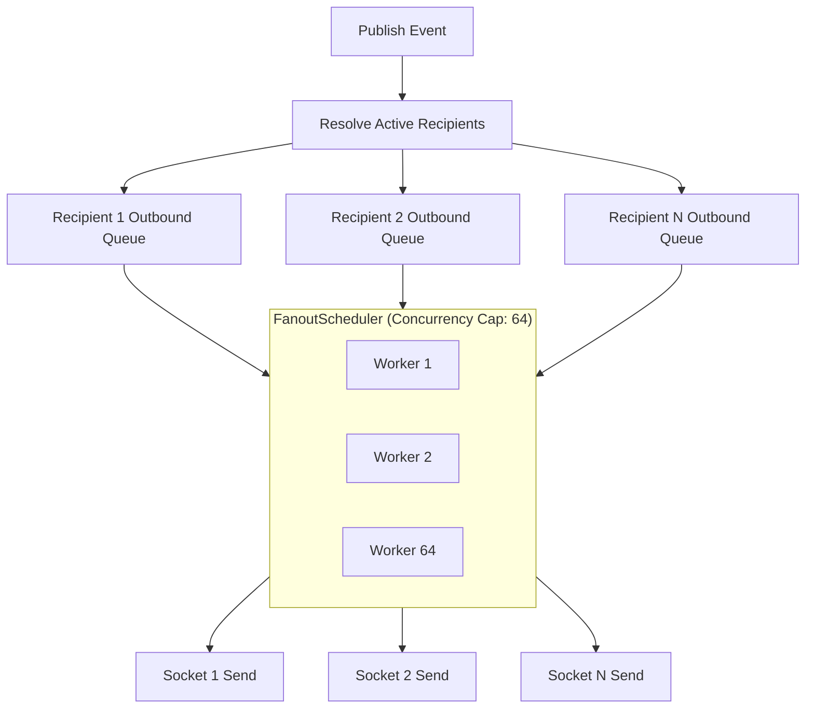

- **Global Concurrency Ceiling**: Limits active async socket writes to 64 concurrent tasks, preventing event loop starvation.
- **Per-Connection Isolation**: Each connection maintains its own FIFO queue. Congestion on Socket A has zero impact on Socket B.
- **Queue Byte Accounting**: Every enqueued frame increments `queuedBytes`. If enqueuing exceeds `maxQueuedBytesPerConnection`, the frame is dropped for that specific peer.

### 8.3 Delivery States

| State | Definition |
|---|---|
| **Accepted** | Inbound frame passed schema validation and authorization checks. |
| **Enqueued** | Outbound frame admitted into the recipient's FIFO queue. |
| **Written** | Frame accepted by uWS C++ buffer for TCP transmission. |
| **Backpressured** | uWS could not accept the frame (kernel buffer full); the send was dropped. |
| **Dropped** | Frame exceeded the per-connection queue cap; discarded without attempting socket write. |
| **Acknowledged** | Application-level delivery confirmation returned by client (optional). |

**Important**: A `backpressured` or `dropped` result means the message was **not** delivered to the peer. `PublishResult` reports partial delivery when any recipient experiences a backpressured or dropped send.

---

## 9. Adaptive Backpressure & Resource Defense

Backpressure in `@oneunit/realtime` is treated as a standard operating condition, not an exceptional error.

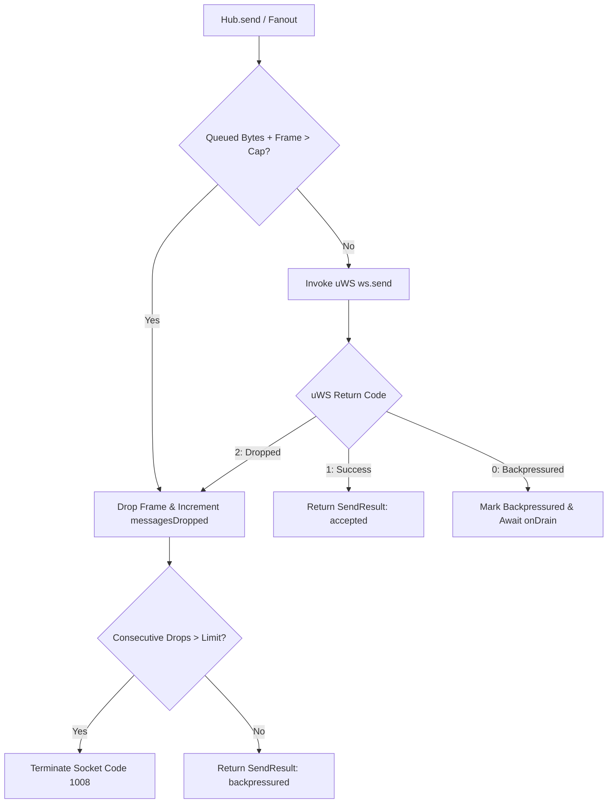

### Defensive Strategies

1. **Memory Ceiling**: If a connection's pending queue exceeds `maxQueuedBytesPerConnection` (default 256 KiB), new frames are dropped immediately and counted as failed delivery.
2. **uWS C++ Backpressure Monitoring**: `socket.bufferedBytes()` reflects native kernel and uWS buffer sizes. If `maxBackpressure` is hit, uWS stops reading from the client and triggers `onDrain` when the buffer subsides. A backpressured result means the frame was **not** written to the socket.
3. **Delivery-Aware Fan-Out**: The router inspects each transport `SendResult`. Only frames with `status: "accepted"` count as delivered. Backpressured and dropped frames increment the failure counter and produce `PublishResult: "partial"`.
4. **No-Throw Guarantee**: `Hub.publish()` and `Hub.broadcast()` **never throw due to backpressure**. They return a typed `PublishResult` reporting partial delivery.
5. **Slow Consumer Termination**: Unresponsive clients that exceed consecutive backpressure drop thresholds are terminated to prevent resource exhaustion.

---

## 10. Single-Timer Heartbeat & Liveness Engine

Spawning individual timers (`setInterval`) for tens of thousands of active sockets causes massive event loop overhead and timer drift in Node.js.

`@oneunit/realtime` utilizes a **single, shared, unref'd timer** to monitor the entire connection fleet:

```
[Registry Index] ─── Connection A (lastSeenAt: 10:00:15) ───► Healthy
                 ─── Connection B (lastSeenAt: 10:00:02) ───► Healthy
                 ─── Connection C (lastSeenAt: 09:58:10) ───► EXPIRED (Terminated)
```

1. **Sliding Window Tracking**: Every inbound byte updates `connection.lastSeenAt`.
2. **Periodic Sweep**: Every `pingIntervalMs` (default 25s), the timer inspects active records.
3. **Deadline Eviction**: If `currentTime - lastSeenAt > pongTimeoutMs` (default 75s), the connection is terminated with reason `"heartbeat expiry"`.
4. **Process Exit Safety**: The timer calls `.unref()`, allowing Node.js to shut down naturally without hanging on the timer.

---

## 11. Subsystem: Presence & Multi-Device Awareness

The `@oneunit/realtime/presence` subsystem manages device leases, multi-device aggregation, and live awareness signals.

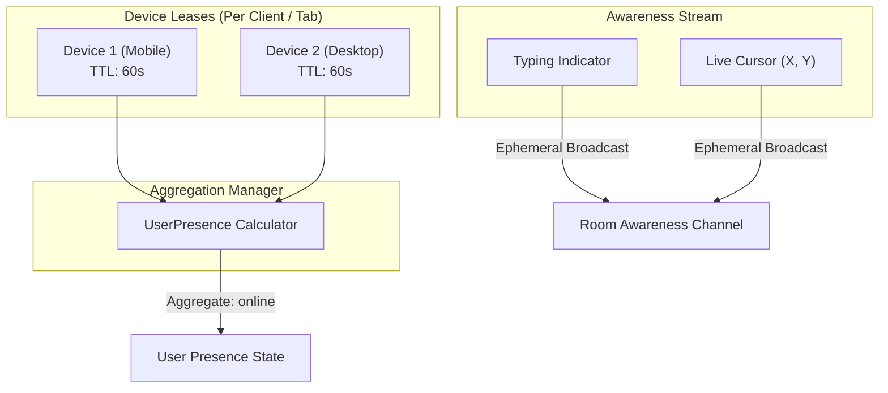

### 11.1 Ephemeral Device Leases

- Devices maintain an ephemeral lease identified by a unique `deviceId`.
- Leases are refreshed via heartbeat frames or regular message activity.
- Expired leases are cleaned up automatically by the `ExpiryManager`.

### 11.2 Multi-Device User Aggregation

A single user may hold active connections across a phone, tablet, and multiple browser tabs. The `AggregationManager` evaluates active device leases to determine the user's aggregate status:
- If **any** device is `active`, user status is `online`.
- If all devices are `idle`, user status is `idle`.
- If all device leases expire, user status transitions to `offline` following an offline grace period.

### 11.3 Ephemeral Awareness Signals

- **Typing Indicators**: Ephemeral `typing_start` / `typing_stop` signals with automatic auto-stop timeouts.
- **Cursor Synchronization**: Lightweight coordinate tracking (`x`, `y`, `elementId`) broadcast to room participants without persisting to disk.

---

## 12. Subsystem: Rooms, Namespaces & Encryption Gates

The `@oneunit/realtime/room-namespace` subsystem enforces isolation across tenants, namespaces, and rooms.

### 12.1 Canonical Room Key Encoding

Room identifiers are encoded into structured composite keys:

$$\text{RoomKey} = \text{tenantId} \parallel \text{":"} \parallel \text{namespace} \parallel \text{":"} \parallel \text{roomId}$$

- Validated by regular expression: `^[a-zA-Z0-9_-]+$`.
- Prevents room hijacking and accidental cross-tenant data leakage.

### 12.2 Dynamic Capacity Enforcement

Rooms enforce maximum participant ceilings (`roomCapacities`). Join operations recheck capacity under concurrency locks, preventing over-subscription races.

### 12.3 Encryption Policy Gates

Rooms configured with `EncryptionPolicy = "e2ee_required"` enforce that:
1. Every joining member possesses a valid cryptographic public key registered in the `KeyDirectory`.
2. Published messages must be sealed `EncryptedEnvelope` payloads matching the current `keyEpoch`. Plaintext broadcasts are strictly rejected.

---

## 13. Subsystem: CRDT Collaborative Editing

The `@oneunit/realtime/collab` subsystem provides conflict-free collaborative editing for text and structured documents without requiring operational transformation (OT) servers.

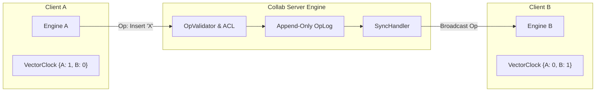

### 13.1 Mathematical Foundations

1. **Replicated Growable Array (RGA)**:
   - Used for concurrent plain-text editing.
   - Text elements are assigned unique identifiers: `(sequenceNumber, actorId)`.
   - Deleted characters are marked with tombstones to maintain causal order.
   - Concurrent insertions at the same position are deterministically sorted by `actorId`.
2. **Last-Write-Wins Map (LWW-Map)**:
   - Used for document attributes and metadata.
   - Key-value assignments carry a logical timestamp and actor ID to resolve concurrent writes deterministically.
3. **Vector Clocks**:
   - Provide partial ordering of operations, ensuring that dependent operations are applied in causal order across all replicas.

---

## 14. Subsystem: End-to-End Encryption (E2EE)

The `@oneunit/realtime/e2ee` subsystem implements a zero-knowledge relay architecture. The server acts as a blind routing node, forwarding ciphertext without holding private keys or viewing plaintext.

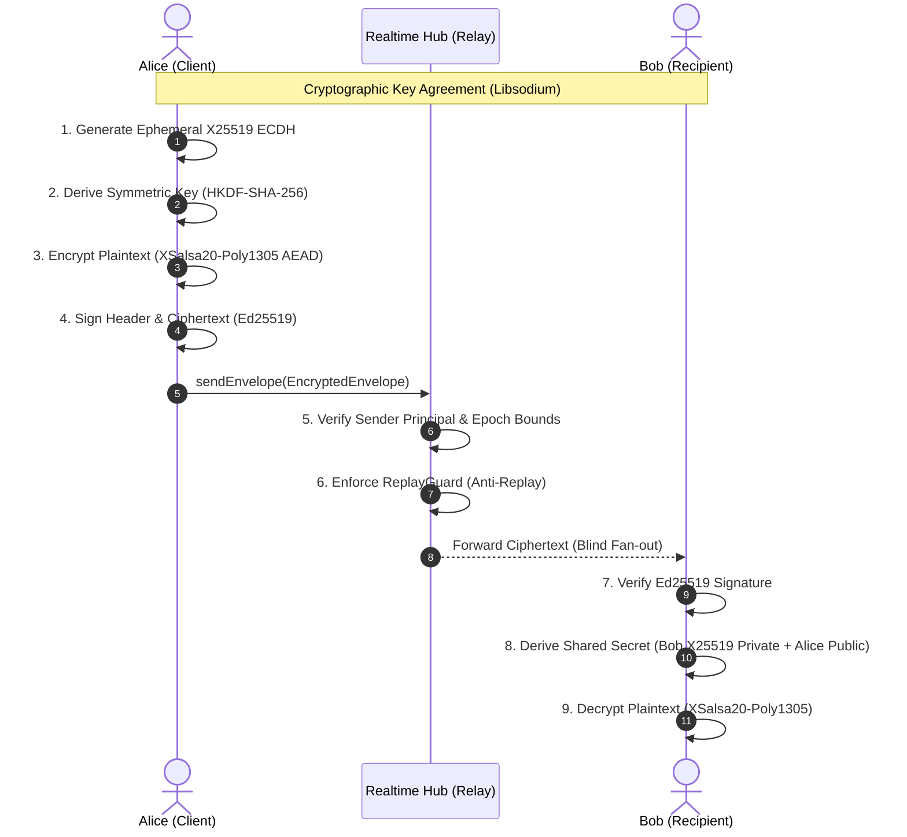

### 14.1 Cryptographic Primitives

- **Asymmetric Key Exchange**: X25519 (Elliptic Curve Diffie-Hellman over Curve25519).
- **Key Derivation Function**: HKDF-SHA-256.
- **Authenticated Encryption**: XSalsa20-Poly1305 (256-bit key, 24-byte nonce, 128-bit MAC).
- **Digital Signatures**: Ed25519 (EdDSA over Curve25519).

### 14.2 Replay Protection with `ReplayGuard`

Every envelope includes a monotonic sequence number, timestamp, and unique message ID. The `ReplayGuard` maintains a bounded replay cache to detect and drop duplicated or replayed envelopes.

- **Atomic Claim**: `consume(senderDeviceId, messageId)` atomically checks and claims a message ID in one operation. Returns `true` if newly claimed, `false` if already seen (duplicate). A single shared guard instance cannot race with itself.
- **Bounded Memory**: The guard is capped at a configurable maximum entry count (default 10,000). When capacity is reached, the oldest entry is evicted (LRU) before inserting a new one, preventing unbounded memory growth on long-running connections.
- **Fail-Closed**: A `false` result causes `open()` to reject the envelope with `ReplayError`, preventing any duplicate or replayed message from being decrypted.

---

## 15. First-Party Client SDK Architecture

`@oneunit/realtime/client` is an isomorphic, browser-safe client library designed with zero native or Node-only dependencies.

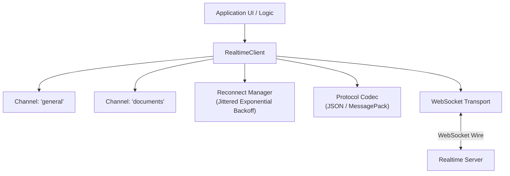

### SDK Responsibilities

1. **Auto-Reconnection**: Reconnects with exponential backoff and randomized jitter to prevent thundering herd problems during server restarts.
2. **Channel Multiplexing**: Channels share a single underlying WebSocket connection.
3. **Transparent Protocol Codec**: Encodes and decodes frames automatically, providing developers with clean, typed JavaScript objects.
4. **Subscription Resumption**: Automatically rejoins subscribed rooms and re-establishes presence upon reconnection.

---

## 16. Concurrency, Atomicity & Ordering Guarantees

### 16.1 Node.js Event Loop Interleaving

While JavaScript execution is single-threaded, asynchronous operations interleave at `await` boundaries. The hub enforces safety across asynchronous gaps:
- **State Re-verification**: `joinRoom` and `publish` verify that the connection has not entered `closing` or `closed` state after returning from `await authorize()`.
- **Atomic Registry Operations**: Membership indexing (`Map` and `Set` operations) occurs synchronously, preventing race conditions during registration and deletion.

### 16.2 Message Ordering

- **Per-Socket FIFO Guarantee**: Messages transmitted by a single client over its TCP connection are processed in strict FIFO arrival order.
- **Per-Room Fan-Out Order**: Messages enqueued for delivery to a recipient are scheduled in arrival sequence.
- **Global Ordering**: The hub provides local per-process ordering. Global cross-instance ordering requires an external sequenced broker (e.g., Kafka partition or Redis Stream).

---

## 17. Fault Isolation, Resilience & Error Model

### 17.1 Failure Domains

The runtime guarantees strict containment across six isolation domains:

```
[Domain: Message]    Malformed frame rejected ───► Socket stays open
[Domain: Socket]     Slow consumer drops      ───► Other sockets unaffected
[Domain: Room]       Room capacity saturated  ───► Other rooms operate normally
[Domain: Adapter]    uWS listener crash       ───► State safely drained
[Domain: Observer]   Logging / Metrics throws ───► Core routing unimpeded
[Domain: Process]    OOM or fatal crash       ───► Clients fail over to sister pod
```

### 17.2 Sanitized Public Error Mapping

Internal exceptions are mapped through `ErrorRegistry`. Secret tokens, passwords, database errors, and internal stack traces are redacted before errors are dispatched to clients:

```typescript
// Sanitized client error frame format
{
  protocolVersion: 1,
  type: "error",
  error: {
    code: "ROOM_FULL",
    message: "Room 'vip' has reached its capacity limit.",
    requestId: "req-f91a-42c8"
  }
}
```

### 17.3 Resilience Tools

The `@oneunit/realtime/errors` module includes built-in resilience utilities:
- `CircuitBreaker`: Prevents cascading backend failures during auth or database outages.
- `withRetry`: Retries transient failures using exponential backoff.
- `withDeadline`: Enforces execution timeouts on async hooks.

---

## 18. Multi-Node Federation & Broker Scaling

Because `@oneunit/realtime` is strictly single-process, horizontal scalability is achieved by federating multiple independent nodes via an external message broker.

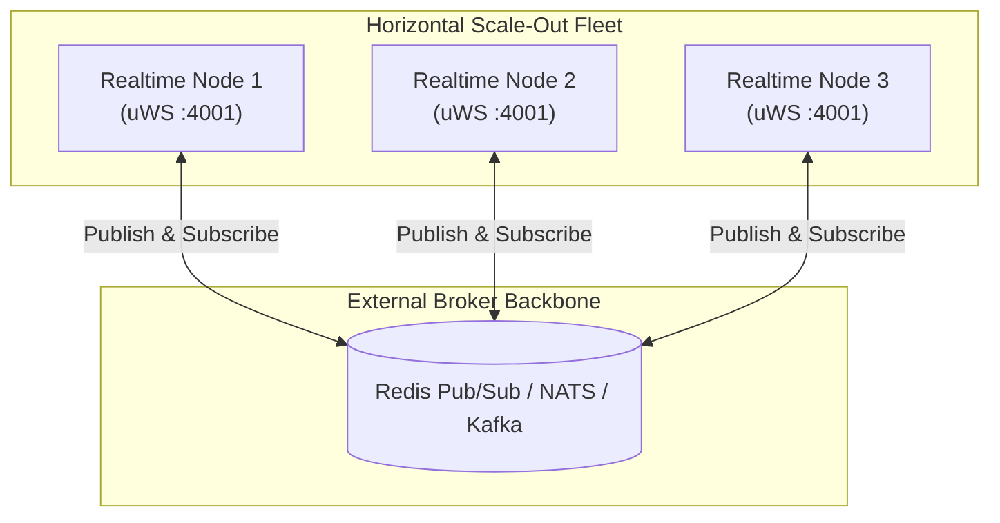

### 18.1 The `BroadcastTarget` Contract

The `Hub` implements the `BroadcastTarget` contract directly:

```typescript
export interface BroadcastTarget {
  broadcast(channelName: string, message: unknown, options?: BroadcastOptions): Promise<number> | number;
}
```

Any external subscriber (Redis, NATS, Kafka) feeds messages directly into `hub.broadcast(channel, payload)`, achieving instant fan-out across all local connections subscribed to that channel.

### 18.2 Broker Failure Modes

Applications choose between two operational policies during broker outages:
1. **Strict Cluster Mode**: If the broker connection fails, incoming publishes are rejected to prevent split-brain state.
2. **Degraded Local Mode**: Publishes continue to be delivered to local clients connected to the same node, while logging warnings that cross-node delivery is degraded.

---

## 19. Memory Layout & Capacity Engineering

### 19.1 Memory Budget Per Connection

Under production configuration with `uWebSockets.js` v20:
- **uWS Native Socket**: ~2.5 KiB (C++ TCP control block & SSL context).
- **`UwsTransportConnection` Instance**: ~1.2 KiB (V8 JavaScript object & listener references).
- **`ClientConnection` Record**: ~1.5 KiB (Metadata, principal, timestamps).
- **Outbound Buffer Allocation**: 0 KiB when idle; up to `maxQueuedBytesPerConnection` (default 256 KiB) under active fan-out.

**Baseline Memory Estimate:** 10,000 idle concurrent connections require approximately **~55–65 MB** of heap/native memory.

### 19.2 Recommended Production Limits

```typescript
const productionConfig: RealtimeConfig = {
  limits: {
    maxConnections: 50_000,
    maxPayloadBytes: 256 * 1024,        // 256 KiB
    maxBackpressureBytes: 512 * 1024,   // 512 KiB
    authTimeoutMs: 7_500,               // 7.5 seconds
  },
};
```

---

## 20. Verification, Testing & Fault Injection

The codebase is validated by a comprehensive automated test suite (200+ tests across 12 test suites) running under `vitest`:

```
test/
├── core/                         # Hub unit tests (state machine, capacity, rooms)
├── transport/                    # uWS transport contract tests & integration
├── protocol/                     # Codec framing, magic byte sniffer, validation
├── presence/                     # Leases, aggregation, awareness, expiry
├── room-namespace/               # Namespace routing, room keys, encryption gates
├── collab/                       # RGA text convergence, vector clocks, LWW-Map
├── e2ee/                         # Libsodium sealing, unsealing, replay protection
├── event/                        # EventService, delivery modes, fan-out scheduler
├── error/                        # Error registry, circuit breaker, retry deadlines
├── client/                       # Client SDK, channel multiplexing, auto-reconnect
└── integration/                  # End-to-end full server handshake & fan-out tests
```

### Fault Injection Testing

The test harness uses deterministic `FakeTransport` instances and mock clocks to verify edge-case resilience:
- **Simulated Backpressure**: Outbound socket returns `backpressured`, verifying that queues honor byte limits.
- **Throwing Transports**: Sockets throw unhandled I/O exceptions, verifying that the hub catches them, tears down the socket, and preserves other active broadcasts.
- **Auth Stalls**: Asynchronous authentication hooks hang indefinitely, verifying that `authTimeoutMs` triggers clean teardown without memory leaks.
- **Replay Attacks**: Duplicate E2EE envelopes are injected, verifying that `ReplayGuard` rejects them immediately.
