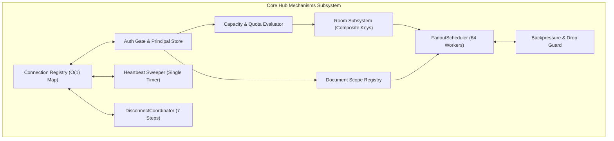

# `@oneunit/realtime`

<p align="center">
  <strong>Single-process realtime WebSocket infrastructure for Node.js (Beta).</strong>
  <br/>
  In-memory channels · uWebSockets.js transport · Adaptive backpressure · Shared heartbeat timer<br/>
  Verified auth hooks · Browser-safe client SDK · Libsodium E2EE · In-process CRDT collaboration
</p>

<p align="center">
  <a href="https://www.npmjs.com/package/@oneunit/realtime"></a>
  <a href="https://github.com/oneunitjs/realtime/blob/main/LICENSE"></a>
  
  
  
  
</p>

> [!NOTE]
> **Beta Release**: `@oneunit/realtime` is currently in active development (`v1.0.0-beta`). APIs, wire contracts, and internal interfaces are subject to refinement before a stable release. It is designed for testing, prototyping, and evaluation, and is **not yet recommended for production use**.

---

## Table of Contents

- [Overview](#overview)
  - [What It Is](#what-it-is)
  - [What It Is NOT](#what-it-is-not)
- [Primary Use Cases](#primary-use-cases)
- [Key Advantages & Unique Selling Points](#key-advantages--unique-selling-points)
- [The Core Mechanisms ("Machisms") Component](#the-core-mechanisms-machisms-component)
  - [Core Logic & Execution Invariants](#core-logic--execution-invariants)
  - [Structural Design & Internal Topography](#structural-design--internal-topography)
  - [Integration Patterns](#integration-patterns)
- [Installation](#installation)
- [Granular Subpath Imports](#granular-subpath-imports)
- [Quick Start](#quick-start)
- [How to Implement the System](#how-to-implement-the-system)
  - [1. Server Implementation with createRealtime](#1-server-implementation-with-createrealtime)
  - [2. Client Implementation with createRealtimeClient](#2-client-implementation-with-createrealtimeclient)
  - [3. Pre-Handshake Authentication & Principal Binding](#3-pre-handshake-authentication--principal-binding)
  - [4. Fine-Grained Authorization Hooks](#4-fine-grained-authorization-hooks)
  - [5. Room & Channel Operations](#5-room--channel-operations)
  - [6. Collaborative Documents with CRDTs](#6-collaborative-documents-with-crdts)
  - [7. Ephemeral Awareness & Multi-Device Presence](#7-ephemeral-awareness--multi-device-presence)
  - [8. End-to-End Encryption (E2EE) with Libsodium](#8-end-to-end-encryption-e2ee-with-libsodium)
  - [9. HTTP Framework Coordinated Shutdown (Express / Fastify / Koa)](#9-http-framework-coordinated-shutdown-express--fastify--koa)
- [Practical Deployment Scenarios](#practical-deployment-scenarios)
  - [Scenario A: Standalone Microservice](#scenario-a-standalone-microservice)
  - [Scenario B: Reverse Proxy Routing (Nginx / Caddy)](#scenario-b-reverse-proxy-routing-nginx--caddy)
  - [Scenario C: Multi-Node Horizontally Scaled Cluster (Redis Pub/Sub)](#scenario-c-multi-node-horizontally-scaled-cluster-redis-pubsub)
  - [Scenario D: Containerized Kubernetes Deployment with Graceful Drain](#scenario-d-containerized-kubernetes-deployment-with-graceful-drain)
- [Capacity Limits & Adaptive Backpressure](#capacity-limits--adaptive-backpressure)
- [Error Handling & Error Code Dictionary](#error-handling--error-code-dictionary)
- [Architecture & Verification](#architecture--verification)
- [License](#license)

---

## Overview

### What It Is

`@oneunit/realtime` is a **high-throughput, transport-neutral, single-process realtime runtime for Node.js (20+)**. Built from the ground up for high-performance interactive applications, it manages the full lifecycle of real-time communication in a single process:

- **Transport-Neutral Core**: The core hub operates entirely on an abstract `TransportConnection` contract (`send`, `close`, `terminate`, `bufferedBytes`, `onMessage`, `onClose`, `onDrain`). The core has zero dependencies on WebSockets, HTTP frameworks, or brokers, making business logic and membership graphs fully testable in memory.
- **Kernel-Grade uWebSockets.js v20 Engine**: Native WebSocket I/O is powered by C++ event loop integration via `uWebSockets.js` v20, delivering high frame throughput, microsecond fan-out latencies, and minimal memory overhead (~2–4 KiB per idle socket).
- **In-Memory Channel & Document Subscriptions**: Lightweight local named subscription groups for rooms and document state fan-out with configurable sender echo behavior.
- **Multi-Device Presence & Awareness**: Track user leases across multiple browser tabs and devices with aggregated online/idle statuses, live typing indicators, and cursor positions.
- **Zero-Trust Security & Pre-Handshake Auth**: Connections are strictly authenticated before socket promotion or membership admission. Fine-grained async authorization gates every join, read, write, and publish action.
- **Deterministic Backpressure & Resource Defense**: Protection against slow consumers, memory leaks, and buffer bloat via per-connection queue caps (`maxQueuedBytesPerConnection`), frame size limits, and backpressure drop policies.
- **Single O(N) Shared Heartbeat Sweeper**: A single unref'd timer loop sweeps all registered sockets, eliminating per-socket timer allocations and avoiding event loop degradation.
- **Native CRDT Collaboration**: Integrated Conflict-free Replicated Data Types (RGA for text, LWW-Map for metadata) with Vector Clocks for causal consistency.
- **Provable End-to-End Encryption (E2EE)**: Zero-knowledge Libsodium envelope encryption (X25519, HKDF-SHA-256, XChaCha20-Poly1305, Ed25519). The hub routes encrypted ciphertext envelopes blindly without possessing private keys or decrypting payloads.
- **Browser-Safe Client SDK**: A client SDK (`@oneunit/realtime/client`) with zero server dependencies, automatic reconnection with jittered exponential backoff, typed channels, and presence hooks.

```
   Browser / Native Clients / SDK
                  │  (WebSocket: JSON or MessagePack)
                  ▼
  ┌────────────────────────────────────────────────────────┐
  │  Transport Layer: uWebSockets.js v20 (Dedicated/Native)│
  │  - Fast C++ TCP / HTTP Upgrade Engine                 │
  │  - Immediate ArrayBuffer Memory Safety Copy            │
  └───────────────────────┬────────────────────────────────┘
                          │ TransportConnection Contract
                          ▼
  ┌────────────────────────────────────────────────────────┐
  │  Core Hub Runtime (Zero Transport / Zero Broker Deps)  │
  │  - Pre-Handshake Auth & Async Authorization Gates      │
  │  - Connection Registry & Idempotent Disconnect State   │
  │  - Room / Channel Membership & Dynamic Capacity Bounds │
  │  - Presence & Awareness Lease Aggregation              │
  │  - FanoutScheduler (Bounded Outbound Queues)           │
  │  - Libsodium E2EE Blind Envelope Router                │
  │  - CRDT Collaboration Synchronization Engine           │
  │  - Single Shared Heartbeat Sweeper Timer               │
  └───────────────────────┬────────────────────────────────┘
                          │ BroadcastTarget (Optional)
                          ▼
             External Broker Adapter (Yours)
             [Redis Pub/Sub / NATS / Kafka / AMQP]
```

### What It Is NOT

- **Not a distributed broker:** No Kafka, Redis, RabbitMQ, or NATS client is bundled into this package. The hub is single-process. When scaling across multiple processes or containers, wire an external broker to the hub's `BroadcastTarget` interface.
- **Not an opinionated framework:** It does not dictate database models, ORMs, dependency injection schemes, or session stores. You provide simple async hooks for authentication and authorization.
- **Not a TLS replacement:** E2EE provides cryptographic payload confidentiality against wire observers and blind server operators. It does not replace transport security. Always serve public or remote traffic over `wss://`.

---

## Primary Use Cases

1. **Group Chat & Team Messaging**: Multi-room chat, direct 1-to-1 conversations, thread fan-out, message history delivery, and read receipts with high concurrency and low memory usage.
2. **Real-Time Collaborative Workspaces**: Google Docs or Figma-style co-editing powered by the built-in CRDT engine (convergent text via RGA, conflict-free metadata via LWW-Map, and causal tracking via Vector Clocks).
3. **Live Presence & Ephemeral Awareness**: Real-time user statuses ("online", "idle", "busy"), live typing indicators, and multi-user cursor tracking synchronized across browser viewports.
4. **Privacy-Critical & Zero-Knowledge Applications**: Regulated messaging (healthcare, finance, internal communications) where the server must route encrypted envelopes blindly without accessing plaintext.
5. **High-Frequency Live Dashboards & Push Feeds**: Financial market feeds, sports scores, IoT telemetry, and live auction platforms that require sub-millisecond fan-out and strict backpressure isolation.
6. **Edge WebSocket Termination Gateways**: High-performance ingress instances running uWebSockets.js that terminate millions of long-lived client sockets, authenticate requests at the edge, and feed backend systems.

---

## Key Advantages & Unique Selling Points

| Feature | `@oneunit/realtime` | Standard `ws` / `Socket.io` |
|---|---|---|
| **Core Architecture** | Fully transport-neutral hexagonal design | Hard-coded to specific socket implementations |
| **WebSocket Engine** | Native C++ `uWebSockets.js` v20 | Pure JavaScript Node `ws` engine |
| **Backpressure Handling** | Explicit per-socket queue limits & backpressure drops | Unbounded internal memory buffer growth |
| **Heartbeat Model** | Single O(N) unref'd timer for all connections | Per-socket `setInterval` timers (event loop strain) |
| **Authorization** | Fine-grained async hooks per action (`join`, `publish`, etc.) | Ad-hoc middleware or socket-level only |
| **Client Identity** | Zero-trust verified `Principal` bound at handshake | Arbitrary client claims trusted in messages |
| **Encryption** | Native Libsodium E2EE envelope routing | Must be implemented manually from scratch |
| **Collaboration** | Built-in CRDT engine (RGA, LWW-Map, Vector Clocks) | Requires separate Yjs/Automerge integration |
| **Presence Engine** | Ephemeral device lease aggregation with TTL expiry | Simple set/map of connection IDs |
| **Packaging** | Zero-leak granular subpath exports with browser-safe client | Monolithic bundle mixing client and server code |

---

## The Core Mechanisms ("Machisms") Component

The runtime engine of `@oneunit/realtime` is architected around a unified suite of **Core Mechanisms** (the foundational "machisms" that drive connection admission, synchronization, resource allocation, and fault isolation). Rather than treating real-time interactions as loose event listeners, each mechanism enforces strict invariant contracts:

```
  ┌────────────────────────────────────────────────────────────────────────┐
  │                   Core Mechanisms ("Machisms") Engine                  │
  ├──────────────────────────────────┬─────────────────────────────────────┤
  │ 1. Handshake & Admission         │ Origin validation, provisional state│
  │ 2. Auth & Principal Binding      │ Deadline-bounded token verification │
  │ 3. Room & Capacity Reservation   │ Atomic slot check & composite keys  │
  │ 4. Document Scope & Subscriptions│ Tenant-partitioned collaborative set│
  │ 5. FanoutScheduler Dispatch      │ Concurrency cap (64), per-peer queue│
  │ 6. Adaptive Backpressure Defense │ Drop limits, consecutive-drop purge │
  │ 7. Single Heartbeat Sweeper      │ Sliding window, unref'd O(N) sweep  │
  │ 8. Idempotent 7-Step Disconnect  │ Single-flight teardown pipeline     │
  │ 9. CRDT State Convergence        │ Vector clocks, causal RGA ordering  │
  │ 10. E2EE Envelope & Replay Guard │ Libsodium AEAD, anti-replay window  │
  │ 11. Presence Lease Aggregator    │ Multi-device aggregate status & TTL │
  └──────────────────────────────────┴─────────────────────────────────────┘
```

### Core Logic & Execution Invariants

1. **Handshake & Admission Logic**:
   - The transport layer checks request origins and frame size limits before allocating memory.
   - A provisional connection is registered in `connecting` state with an attached `AbortController`.
   - If authentication does not complete within `authTimeoutMs` (default: 7.5s), the `AbortController` fires, tearing down the provisional record.
2. **Authentication & Principal Binding**:
   - Identity is established strictly via the `authenticate` hook using pre-handshake query parameters or `Authorization` headers.
   - The verified token yields an immutable `AuthenticatedPrincipal` (`userId`, `tenantId`, `roles`, `sessionId`).
   - Sockets transition to `authenticated` only after principal binding; client-supplied identity claims in message bodies are never trusted.
3. **Room & Namespace Capacity Reservation**:
   - Room membership uses composite keys: `tenantId:namespace:roomId`.
   - Capacity quotas are evaluated atomically before membership is committed.
   - Rechecks occur after any asynchronous gap (`await`) to ensure state validity under concurrent joins.
4. **Fanout Scheduling & Outbound Queue Draining**:
   - The `FanoutScheduler` bounds global async write concurrency to 64 concurrent tasks.
   - Each socket maintains an independent outbound FIFO queue. A congested socket never delays delivery to healthy sockets.
   - If an outbound queue exceeds `maxQueuedBytesPerConnection` (default: 256 KiB), the frame is dropped for that peer (`status: "backpressured"`).
5. **Backpressure & Slow-Consumer Purge**:
   - Monitored via native uWS buffer depth (`socket.bufferedBytes()`).
   - If consecutive frame drops exceed threshold limits, the connection is terminated with code `1008`.
6. **Single Heartbeat Sweeper**:
   - A single `setInterval` timer (unref'd) sweeps the connection registry every `pingIntervalMs` (25s).
   - Silent connections exceeding `pongTimeoutMs` (75s) without inbound activity are expired with reason `"heartbeat expiry"`.
7. **Idempotent 7-Step Disconnect Pipeline**:
   - Managed by `DisconnectCoordinator`:
     1. Mark `closing` & abort `AbortController`.
     2. Remove room memberships & notify leave hooks.
     3. Remove document subscriptions.
     4. Release presence leases & recalculate aggregates.
     5. Clear outbound queues.
     6. Terminate transport socket.
     7. Mark `closed`, delete indexes, decrement counters.

### Structural Design & Internal Topography



### Integration Patterns

- **HTTP Framework Pattern**: Frameworks (Express, Fastify, Koa) own the standard HTTP routes; `@oneunit/realtime` owns the WebSocket port. Lifecycle hooks coordinate process termination.
- **Broker Adapter Pattern**: Connect horizontal clusters by wiring `hub.broadcast(channel, payload)` to Redis Pub/Sub, Kafka, or NATS subscribers.
- **Persistence Pattern**: Connect document state and operation logs to durable databases using the `CollaborationStorage` contract.

---

## Installation

```bash
npm install @oneunit/realtime
```

**Requirements:**
- **Node.js**: `v20.0.0` or higher
- **Runtime Dependencies**: `uwebsocket` (uWebSockets.js v20.70.0), `libsodium-wrappers` (^0.8.4), `notepack.io` (^3.0.1)

---

## Granular Subpath Imports

Import only the components required by your service:

```typescript
// 1. Full public facade
import { createRealtime, anonymousAuthProvider } from "@oneunit/realtime";

// 2. Core Hub runtime (Zero WebSocket or uWS dependencies)
import { Hub, createHub } from "@oneunit/realtime/hub";

// 3. Browser-safe Client SDK
import { createRealtimeClient } from "@oneunit/realtime/client";

// 4. Transport adapter & contracts
import { UwsTransportAdapter, createUwsTransport } from "@oneunit/realtime/adapter";

// 5. CRDT collaboration engine
import { CollaborationEngine, RGA, VectorClock } from "@oneunit/realtime/collab";

// 6. End-to-End Encryption (Libsodium)
import { EnvelopeService, generateDeviceKeys } from "@oneunit/realtime/e2ee";

// 7. Presence & awareness subsystem
import { PresenceService, MemoryPresenceStore } from "@oneunit/realtime/presence";

// 8. Room & namespace management
import { RoomNamespaceRouter, encodeRoomKey } from "@oneunit/realtime/room-namespace";

// 9. Wire protocol codecs & envelopes
import { encodeFrame, decodeFrame, jsonCodec, messagepackCodec } from "@oneunit/realtime/protocol";

// 10. Typed errors & resilience utilities
import { HubError, ConnectionLimitError, CircuitBreaker } from "@oneunit/realtime/error";

// 11. Framework lifecycle integrations
import { expressRealtime, fastifyRealtime, koaRealtime, nodeHttpRealtime } from "@oneunit/realtime/express";
```

---

## Quick Start

### Minimal Server

```typescript
import { createRealtime, anonymousAuthProvider } from "@oneunit/realtime";

const realtime = createRealtime({
  port: 4001,
  path: "/ws",
  authenticate: anonymousAuthProvider.authenticate,
});

await realtime.listen();
console.log(`Server listening at ${realtime.wsUrl}`);
// ws://127.0.0.1:4001/ws
```

### Minimal Client

```typescript
import { createRealtimeClient } from "@oneunit/realtime/client";

const client = createRealtimeClient({
  url: "ws://127.0.0.1:4001/ws",
  codec: "json",
  auth: { token: async () => "demo-token" },
});

await client.connect();

const chat = client.channel<{ text: string }>("lobby");
chat.onMessage((msg) => console.log("Received:", msg.text));

await chat.join();
await chat.send({ text: "Hello Realtime!" });
```

---

## How to Implement the System

### 1. Server Implementation with createRealtime

```typescript
import { createRealtime } from "@oneunit/realtime";

const realtime = createRealtime({
  port: 4001,
  host: "0.0.0.0",
  path: "/ws",
  allowedOrigins: ["https://myapp.com", "http://localhost:3000"],
  
  limits: {
    maxConnections: 25_000,
    maxPayloadBytes: 128 * 1024,        // 128 KiB
    maxBackpressureBytes: 512 * 1024,   // 512 KiB queue cap per socket
    authTimeoutMs: 5_000,               // 5s deadline
  },

  roomCapacities: {
    "vip-lounge": 50,
    "general": 5_000,
  },

  authenticate: async (context) => {
    const token = context.query.token ?? context.headers["authorization"]?.replace(/^Bearer\s+/i, "");
    if (!token) throw new Error("Missing auth token");

    const session = await verifyToken(token);
    return {
      userId: session.userId,
      tenantId: session.tenantId,
      roles: session.roles,
      sessionId: session.id,
    };
  },

  authorize: async (action, principal, resourceId, tenantId) => {
    if (principal.tenantId !== tenantId) return false;
    if (action === "room:join" && resourceId === "admin-channel") {
      return principal.roles?.includes("admin") ?? false;
    }
    return true;
  },
});

await realtime.listen();
console.log(`Realtime gateway running at ${realtime.wsUrl}`);
```

### 2. Client Implementation with createRealtimeClient

```typescript
import { createRealtimeClient } from "@oneunit/realtime/client";

const client = createRealtimeClient({
  url: "wss://api.myapp.com/ws",
  codec: "messagepack",
  reconnect: {
    enabled: true,
    maxAttempts: 10,
    baseDelayMs: 1_000,
    maxDelayMs: 30_000,
  },
  auth: {
    token: async () => await getFreshJwtToken(),
  },
});

client.on("connected", () => console.log("Connected to Realtime Gateway"));
client.on("disconnected", () => console.warn("Socket disconnected"));
client.on("error", (err) => console.error("Client error:", err));

await client.connect();

const channel = client.channel<{ text: string; sender: string }>("updates");
channel.onMessage((msg) => console.log(`[${msg.sender}]: ${msg.text}`));

await channel.join();
await channel.send({ text: "Hello World", sender: "Alice" });
```

### 3. Pre-Handshake Authentication & Principal Binding

```typescript
import { createRealtime, credentialFromHandshake } from "@oneunit/realtime";

const realtime = createRealtime({
  authenticate: async (context) => {
    const credential = credentialFromHandshake(context);
    if (!credential) throw new Error("Authentication credential required");

    const decoded = await verifyJwt(credential);
    return {
      userId: decoded.sub,
      tenantId: decoded.tenant_id ?? "default",
      roles: decoded.roles ?? ["user"],
      sessionId: decoded.jti,
    };
  },
});
```

### 4. Fine-Grained Authorization Hooks

```typescript
const realtime = createRealtime({
  authorize: async (action, principal, resourceId, tenantId) => {
    switch (action) {
      case "room:join":
        return await permissions.canJoinRoom(principal.userId, resourceId);
      case "room:leave":
        return true;
      case "document:read":
        return await permissions.canReadDoc(principal.userId, resourceId);
      case "document:write":
        return principal.roles?.includes("editor") ?? false;
      case "event:publish":
        return !principal.roles?.includes("restricted");
      default:
        return false;
    }
  },
});
```

### 5. Room & Channel Operations

```typescript
// Query room state
const count = realtime.hub.memberCount("project-1");
const memberIds = realtime.hub.roomMembers("project-1");

// Server-initiated broadcast (sender excluded by default)
const result = await realtime.hub.publish("server", {
  type: "message",
  channel: "project-1",
  payload: { alert: "Deployment starting" },
  excludeSender: false,
});

if (result.status === "delivered") {
  console.log(`Sent to ${result.recipientCount} members`);
}
```

### 6. Collaborative Documents with CRDTs

```typescript
import { CollaborationEngine } from "@oneunit/realtime/collab";

const engine = new CollaborationEngine({
  documentId: "doc-shared-notes",
  schemaVersion: 1,
  transport: clientTransport,
});

await engine.connect();
await engine.insertText("ROOT", "Hello Realtime!");
await engine.deleteText("ROOT", 5, 9); // Deletes " Realtime"

console.log(engine.getText()); // "Hello!"
const snapshot = engine.exportSnapshot();
await engine.disconnect();
```

### 7. Ephemeral Awareness & Multi-Device Presence

```typescript
import { PresenceService, MemoryPresenceStore } from "@oneunit/realtime/presence";

const presenceStore = new MemoryPresenceStore();
const presence = new PresenceService({
  store: presenceStore,
  config: { leaseTtlMs: 60_000 },
});

// Register heartbeat lease for device
await presence.heartbeat(
  { userId: "u1", tenantId: "t1", deviceId: "tab-chrome" },
  { userAgent: "Chrome/120" }
);

// Stream ephemeral cursor coordinates
await presence.updateCursor(
  { userId: "u1", tenantId: "t1", deviceId: "tab-chrome" },
  "canvas-room",
  { x: 350, y: 480 }
);

// Query aggregate user presence across all devices
const status = await presence.getUserPresence("u1");
console.log(status.status); // "online" | "idle" | "offline"
```

### 8. End-to-End Encryption (E2EE) with Libsodium

```typescript
import {
  EnvelopeService,
  generateDeviceKeys,
  e2eeReady,
} from "@oneunit/realtime";

await e2eeReady();

const aliceKeys = generateDeviceKeys();
const bobKeys = generateDeviceKeys();
const envelopeService = new EnvelopeService();

// Alice seals an encrypted envelope for Bob
const sealed = await envelopeService.seal({
  plaintext: new TextEncoder().encode("Classified payload"),
  recipientPublicKey: bobKeys.x25519PublicKey,
  senderX25519KeyPair: {
    publicKey: aliceKeys.x25519PublicKey,
    privateKey: aliceKeys.x25519PrivateKey,
  },
  senderEd25519KeyPair: {
    publicKey: aliceKeys.ed25519PublicKey,
    privateKey: aliceKeys.ed25519PrivateKey,
  },
  conversationId: "confidential",
  senderUserId: "alice",
  senderDeviceId: aliceKeys.deviceId,
  keyEpoch: 1,
});

// Bob opens the sealed envelope
const opened = await envelopeService.open({
  envelope: sealed,
  recipientX25519PrivateKey: bobKeys.x25519PrivateKey,
  senderEd25519PublicKey: aliceKeys.ed25519PublicKey,
  senderUserId: "alice",
});

console.log(new TextDecoder().decode(opened.plaintext));
// "Classified payload"
```

### 9. HTTP Framework Coordinated Shutdown (Express / Fastify / Koa)

#### Express

```typescript
import express from "express";
import http from "node:http";
import { createRealtime } from "@oneunit/realtime";
import { expressRealtime } from "@oneunit/realtime/express";

const app = express();
const server = http.createServer(app);

const realtime = createRealtime({ port: 4001, path: "/ws" });
await realtime.listen();

expressRealtime(app, realtime, { httpServer: server });
server.listen(3000);
```

#### Fastify

```typescript
import Fastify from "fastify";
import { createRealtime } from "@oneunit/realtime";
import { fastifyRealtime } from "@oneunit/realtime/fastify";

const fastify = Fastify();
const realtime = createRealtime({ port: 4001, path: "/ws" });
await realtime.listen();

await fastify.register(fastifyRealtime(fastify, realtime));
await fastify.listen({ port: 3000 });
```

---

## Practical Deployment Scenarios

### Scenario A: Standalone Microservice

Deploy `@oneunit/realtime` as a dedicated WebSocket service:

```typescript
// server.ts
import { createRealtime } from "@oneunit/realtime";

const realtime = createRealtime({
  port: Number(process.env.PORT ?? 4001),
  host: "0.0.0.0",
  path: "/ws",
  limits: { maxConnections: 50_000 },
});

await realtime.listen();

const shutdown = async () => {
  await realtime.close({ timeoutMs: 5_000 });
  process.exit(0);
};

process.on("SIGINT", () => void shutdown());
process.on("SIGTERM", () => void shutdown());
```

### Scenario B: Reverse Proxy Routing (Nginx / Caddy)

Expose HTTP and WebSockets on a single public port (`443`) via reverse proxy:

```nginx
# /etc/nginx/conf.d/realtime.conf
upstream node_http {
    server 127.0.0.1:3000;
}

upstream uws_realtime {
    server 127.0.0.1:4001;
}

server {
    listen 443 ssl http2;
    server_name api.myapp.com;

    # SSL configuration omitted for brevity

    # Route WebSocket connections to uWebSockets.js
    location /ws {
        proxy_pass http://uws_realtime;
        proxy_http_version 1.1;
        proxy_set_header Upgrade $http_upgrade;
        proxy_set_header Connection "Upgrade";
        proxy_set_header Host $host;
        proxy_set_header X-Forwarded-For $proxy_add_x_forwarded_for;
        proxy_read_timeout 90s;
        proxy_send_timeout 90s;
    }

    # Route REST API traffic to Express / Fastify
    location / {
        proxy_pass http://node_http;
        proxy_set_header Host $host;
        proxy_set_header X-Real-IP $remote_addr;
    }
}
```

### Scenario C: Multi-Node Horizontally Scaled Cluster (Redis Pub/Sub)

Federate multiple independent instances using Redis as the pub/sub backbone:

```typescript
import { createRealtime } from "@oneunit/realtime";
import { Redis } from "ioredis";

const realtime = createRealtime({ port: 4001 });
await realtime.listen();

const pub = new Redis(process.env.REDIS_URL);
const sub = new Redis(process.env.REDIS_URL);

// Inbound: Broker -> Local Hub Fan-out
await sub.psubscribe("realtime:channel:*");
sub.on("pmessage", (_pattern, channel, messageStr) => {
  const channelName = channel.replace("realtime:channel:", "");
  const payload = JSON.parse(messageStr);
  void realtime.hub.broadcast(channelName, payload);
});

// Outbound: Application -> Broker
export async function clusterBroadcast(channel: string, message: unknown) {
  await pub.publish(`realtime:channel:${channel}`, JSON.stringify(message));
}
```

### Scenario D: Containerized Kubernetes Deployment with Graceful Drain

Deploy in Kubernetes with readiness/liveness checks and graceful termination:

```yaml
apiVersion: apps/v1
kind: Deployment
metadata:
  name: realtime-gateway
spec:
  replicas: 3
  template:
    spec:
      terminationGracePeriodSeconds: 30
      containers:
        - name: realtime
          image: myregistry/realtime-service:v1.0.0
          ports:
            - containerPort: 4001
              name: websocket
          livenessProbe:
            tcpSocket:
              port: 4001
            initialDelaySeconds: 5
            periodSeconds: 10
          readinessProbe:
            tcpSocket:
              port: 4001
            initialDelaySeconds: 2
            periodSeconds: 5
          resources:
            requests:
              cpu: "500m"
              memory: "256Mi"
            limits:
              cpu: "2000m"
              memory: "1Gi"
```

---

## Capacity Limits & Adaptive Backpressure

Configure defensive boundaries against heap exhaustion and denial-of-service:

```typescript
const realtime = createRealtime({
  limits: {
    maxConnections: 50_000,            // Connection ceiling
    maxPayloadBytes: 256 * 1024,       // 256 KiB inbound frame ceiling
    maxBackpressureBytes: 512 * 1024,  // 512 KiB outbound buffer limit per socket
    authTimeoutMs: 7_500,              // 7.5s authentication deadline
  },
});
```

- **Per-Socket Isolation**: If a recipient's outbound queue exceeds `maxBackpressureBytes`, further writes to that peer are dropped. Healthy peers continue receiving messages without delay.
- **Unresponsive Peer Eviction**: If consecutive drops exceed safety thresholds, the congested socket is terminated with code `1008`.

---

## Error Handling & Error Code Dictionary

All runtime errors extend `HubError` and carry a machine-readable `code` property. Internal details and credentials are never leaked to clients.

| Error Class | Code | Cause & Mitigation |
|---|---|---|
| `ConnectionLimitError` | `CONNECTION_LIMIT` | Global connection ceiling reached. Scale out or increase `maxConnections`. |
| `MessageTooLargeError` | `MESSAGE_TOO_LARGE` | Inbound frame exceeded `maxPayloadBytes`. Reduce payload size. |
| `RoomFullError` | `ROOM_FULL` | Room reached maximum capacity ceiling. |
| `RateLimitedError` | `RATE_LIMITED` | Client exceeded publish rate limits. |
| `UnauthenticatedError` | `UNAUTHENTICATED` | Token missing or invalid during handshake. |
| `ForbiddenError` | `FORBIDDEN` | Authorization hook denied the requested action. |
| `ValidationFailedError` | `VALIDATION_FAILED` | Inbound frame violated envelope structure or schema. |
| `AuthenticationTimeoutError` | `AUTHENTICATION_TIMEOUT` | Auth provider did not resolve within `authTimeoutMs`. |
| `ConnectionNotAuthenticatedError` | `CONNECTION_NOT_AUTHENTICATED` | Action attempted before authentication completed. |
| `TenantIsolationError` | `TENANT_ISOLATION` | Attempted cross-tenant data access. |
| `CleanupError` | `CLEANUP_ERROR` | Error encountered during connection teardown. |
| `UwsListenFailedError` | `UWS_LISTEN_FAILED` | uWS failed to bind to target port (port collision or permissions). |
| `HandshakeUnauthorizedError` | `HANDSHAKE_UNAUTHORIZED` | Upgrade rejected during pre-handshake authentication. |
| `HandshakeOriginRejectedError` | `HANDSHAKE_ORIGIN_REJECTED` | Request origin header rejected by allowlist. |

---

## Architecture & Verification

- For deep technical specifications on the internal state machines, memory layout, C++ memory copy invariants, and CRDT math, read [`ARCHITECTURE.md`](./ARCHITECTURE.md).
- Run the test suite:
  ```bash
  npm test
  npm run test:integration
  npm run verify
  ```

---

## License

[MIT](./LICENSE) © 2026 mayank
